# riordan-graph-enumerator

[](https://github.com/arnauldmwafise/riordan-graph-enumerator/actions/workflows/ci.yml)
[](LICENSE)

**Exhaustive enumeration of unlabeled Riordan graphs.** This repository computes `u(n)`, the number of
non-isomorphic graphs on `n` vertices that admit a Riordan labeling, for every `n ≤ 17`. Each value is
confirmed by two independently written programs, and for `n ≤ 10` by a third method that tests every
graph on `n` vertices. Two further tools make the graphs themselves accessible:

* **`rglist`** lists every labeled or unlabeled Riordan graph of a given order, with its generating
  functions, Riordan matrix, adjacency matrix and graph visualization.
* **`rgsample`** draws random Riordan graphs of any order up to 64: uniformly over labeled graphs,
  exactly uniformly over unlabeled graphs, or conditioned on subgraph structure. It reports their
  invariants and estimates `u(n)` beyond the exhaustive range.

The enumeration of unlabeled Riordan graphs is posed as an open problem (Problem 2) in

> G.-S. Cheon, J.-H. Jung, S. Kitaev, S. A. Mojallal, *Riordan graphs I: Structural properties*,
> Linear Algebra Appl. **579** (2019) 89–135. [arXiv:1710.04604](https://arxiv.org/abs/1710.04604)

| n | 1 | 2 | 3 | 4 | 5 | 6 | 7 | 8 | 9 | 10 | 11 | 12 | 13 | 14 | 15 | 16 | 17 |
|---|---|---|---|---|---|---|---|---|---|---|---|---|---|---|---|---|---|
| **u(n)** | 1 | 2 | 4 | 11 | 30 | 109 | 406 | 1864 | 8169 | 36897 | 158351 | 671656 | 2657424 | 11481042 | 46683483 | 190658218 | 789399022 |

---

## Contents

1. [Background: what is a Riordan graph?](#1-background-what-is-a-riordan-graph)
2. [Motivation: why counting unlabeled Riordan graphs is hard](#2-motivation-why-counting-unlabeled-riordan-graphs-is-hard)
3. [Results](#3-results)
4. [Worked examples](#4-worked-examples)
5. [Installation](#5-installation)
6. [Quick start](#6-quick-start)
7. [Listing Riordan graphs: `rglist`](#7-listing-riordan-graphs-rglist)
8. [Sampling Riordan graphs: `rgsample`](#8-sampling-riordan-graphs-rgsample)
9. [Counting tools](#9-counting-tools)
10. [Reproducing all results](#10-reproducing-all-results)
11. [Verification strategy](#11-verification-strategy)
12. [Documentation and repository structure](#12-documentation-and-repository-structure)
13. [Citing, license, acknowledgements](#13-citing-license-acknowledgements)

---

## 1. Background: what is a Riordan graph?

A **Riordan array** `(g, f)` is the infinite lower-triangular matrix whose `j`-th column
(`j = 0, 1, 2, …`) has generating function `g(t)·f(t)^j`. Here `g` and `f` are formal power series and
`f(0) = 0`.

Cheon, Jung, Kitaev and Mojallal read such arrays over **Z₂** (coefficients mod 2) as adjacency
matrices.

> **Definition.** Let `g, f ∈ Z₂[[t]]` with `f(0) = 0`. The **labeled Riordan graph** `G_n(g, f)` has
> vertices `1, …, n`. For `i > j`, the pair `ij` is an edge if and only if
> `[tⁱ⁻²] g·fʲ⁻¹ = 1` (mod 2).
>
> A graph is an **(unlabeled) Riordan graph** if it is isomorphic to some `G_n(g, f)`. A numbering of
> its vertices that turns it into some `G_n(g, f)` is called a **Riordan labeling**.

In matrix terms, let `B` be the `(n−1)×(n−1)` leading block of the Riordan array over Z₂:
`B[i][j] = [tⁱ] g·fʲ` for `0 ≤ j ≤ i ≤ n−2`. The strictly lower triangle of the adjacency matrix `A` is
`B` shifted down by one row:

```
A[i][j] = B[i−2][j−1]   for i > j,      A symmetric, zero diagonal.
```

Only `g mod tⁿ⁻¹` matters. If `g ≠ 0` has lowest term `tʳ`, only `f mod tⁿ⁻¹⁻ʳ` matters as well.
Every labeled Riordan graph arises from exactly one such *canonical* pair, which gives the labeled
count

```
L(n) = (4ⁿ⁻¹ + 2) / 3  =  1, 2, 6, 22, 86, 342, 1366, …        (Cheon et al., Prop. 2.8)
```

Familiar examples include the path `G_n(1, t)`, the complete graph `G_n(1/(1−t), t)`, the Pascal graph
`G_n(1/(1−t), t/(1−t))` and the Catalan graph `G_n(C, tC)` with `C` the Catalan series.

## 2. Motivation: why counting unlabeled Riordan graphs is hard

**Labeled versus unlabeled.** In graph enumeration, counting labeled objects is almost always much
easier than counting unlabeled ones. Riordan graphs are an extreme case. Each labeled Riordan graph is
a pair of truncated power series, so `L(n)` has the clean closed form above. But the number of
*isomorphism classes*, `u(n)`, was unknown beyond `n = 4`, where every graph is Riordan. Cheon et al.
list it as an open problem.

**Why the usual tools do not apply.**

* *Burnside's lemma / Pólya theory* count orbits of the symmetric group `S_n` by averaging fixed
  points. Here the set to be acted on is "all graphs on `{1,…,n}` that have *some* Riordan labeling".
  Being Riordan is a property of a **vertex ordering**, not of the graph. That set has no algebraic
  description in terms of `g` and `f`, so the fixed-point counts are not accessible through
  generating functions.
* *Multiplicity varies wildly.* An unlabeled Riordan graph can have one Riordan labeling or
  thousands. For example, at `n = 4` the 22 labeled graphs fall into 11 classes of sizes 1 to 4, and
  at `n = 13` the largest class contains 4650 labeled Riordan graphs. So `u(n)` is not simply
  `L(n)` divided by a constant.
* *No forbidden-subgraph description.* The class is not closed under taking induced subgraphs. For
  example, `G_6(1+t, t²+t³)` is Riordan, but deleting its vertex 4 leaves `C₄ ∪ K₁`, which is not.
  Methods for counting hereditary classes therefore do not apply.
* *Scale.* `L(n)` grows like `4ⁿ`. Computing `u(17)` meant reducing 1.43·10⁹ labeled graphs to
  canonical form and storing about 7.9·10⁸ distinct isomorphism classes. Deciding whether a *single*
  unlabeled graph is Riordan currently needs a search over vertex orderings. The complexity of this
  recognition problem is itself open (Problem 4 of Cheon et al.).

**What this repository provides.** Exact values of `u(n)` for `n ≤ 17`, each confirmed
independently. The data behind related open problems: complements, minimal non-Riordan graphs, and
how many Riordan labelings a graph has. And tools that make every small Riordan graph explicit, so
anyone can inspect the objects being counted.

## 3. Results

### 3.1 The main sequence

| n | labeled `L(n)` | unlabeled `u(n)` | `u(n)/L(n)` | verified by |
|---:|---:|---:|---:|:--|
| 1 | 1 | **1** | 1.000 | A, B, C |
| 2 | 2 | **2** | 1.000 | A, B, C |
| 3 | 6 | **4** | 0.667 | A, B, C |
| 4 | 22 | **11** | 0.500 | A, B, C |
| 5 | 86 | **30** | 0.349 | A, B, C |
| 6 | 342 | **109** | 0.319 | A, B, C |
| 7 | 1 366 | **406** | 0.297 | A, B, C |
| 8 | 5 462 | **1 864** | 0.341 | A, B, C |
| 9 | 21 846 | **8 169** | 0.374 | A, B, C |
| 10 | 87 382 | **36 897** | 0.422 | A, B, C |
| 11 | 349 526 | **158 351** | 0.453 | A, B |
| 12 | 1 398 102 | **671 656** | 0.480 | A, B |
| 13 | 5 592 406 | **2 657 424** | 0.475 | A, B |
| 14 | 22 369 622 | **11 481 042** | 0.513 | A, B |
| 15 | 89 478 486 | **46 683 483** | 0.522 | A, B |
| 16 | 357 913 942 | **190 658 218** | 0.533 | A, B |
| 17 | 1 431 655 766 | **789 399 022** | 0.551 | A, B |

A = `rgcount`, B = `tree_count` (independent code), C = `geng` + `recognize_all` (tests every graph).
See [§10](#10-verification-strategy). Machine-readable: [`data/counts.csv`](data/counts.csv).

### 3.2 Related sequences

| n | 1 | 2 | 3 | 4 | 5 | 6 | 7 | 8 | 9 | 10 |
|---|---|---|---|---|---|---|---|---|---|---|
| graphs that are **not** Riordan | 0 | 0 | 0 | 0 | 4 | 47 | 638 | 10482 | 266499 | 11968271 |
| minimal non-Riordan graphs | 0 | 0 | 0 | 0 | 4 | 17 | 111 | 123 | 232 | 303 |
| connected Riordan graphs | 1 | 1 | 2 | 6 | 19 | 78 | 316 | 1502 | 6969 | 32382 |
| labeled: complement also labeled Riordan | 1 | 2 | 4 | 12 | 28 | 92 | 220 | 732 | 1756 | 5852 |
| unlabeled: complement also Riordan | 1 | 2 | 4 | 11 | 26 | 90 | 230 | 707 | 1591 | 3804 |
| self-complementary Riordan graphs | 1 | 0 | 0 | 1 | 2 | 0 | 0 | 1 | 1 | 0 |

The complement counts are extended to `n = 14` in [docs/COMPUTATIONS.md](docs/COMPUTATIONS.md),
along with Riordan trees and forests, class-size statistics, and data on io-decomposable Riordan
graphs of the Bell type (Problem 6 and Conjecture 2 of Cheon et al.).

## 4. Worked examples

**How to read the examples.**

* For each graph we give the pair `(g, f)`, the columns `g·fʲ` truncated after `tⁿ⁻²`, the lower
  triangular Riordan matrix `B` (rows `i = 0…n−2`, columns `j = 0…i`, `B[i][j] = [tⁱ] g fʲ`), and the
  adjacency matrix `A`.
* Row `i` of `B` is exactly row `i+2` of the lower triangle of `A`.
* Vertex numbers in the drawings are the Riordan labels.

All examples were produced with `build/rglist` (see [§7](#7-listing-riordan-graphs-rglist)). Every graph
below can be regenerated, for instance with `build/rglist 4 --show "1+t^2" t`.

### 4.1 Unlabeled Riordan graphs of order 4

There are `u(4) = 11` unlabeled Riordan graphs of order 4: all graphs on four vertices. Here are two
of them.

<table>
<tr><td align="center">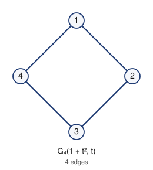<br><b>C₄ = G₄(1 + t², t)</b></td>
<td>

```
g = 1 + t²,  f = t
columns (mod t³):  g = 1 + t²,  g·f = t,  g·f² = t²

B (Riordan matrix)      A (adjacency matrix)
 1                       0 1 0 1
 0 1                     1 0 1 0
 1 0 1                   0 1 0 1
                         1 0 1 0
edges: 12 14 23 34
```
The 4-cycle has exactly one Riordan labeling, so its class has size 1.
</td></tr>
<tr><td align="center">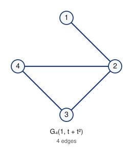<br><b>paw = G₄(1, t + t²)</b></td>
<td>

```
g = 1,  f = t + t²
columns (mod t³):  g = 1,  f = t + t²,  f² = t²

B                       A
 1                       0 1 0 0
 0 1                     1 0 1 1
 0 1 1                   0 1 0 1
                         0 1 1 0
edges: 12 23 24 34
```
A triangle with a pendant vertex. Three labeled Riordan graphs are isomorphic to it.
</td></tr>
</table>

The complete list of all 11 graphs, with drawings and matrices, is in
[examples/unlabeled/order_4.md](examples/unlabeled/order_4.md).

### 4.2 Unlabeled Riordan graphs of order 5

Of the 34 graphs on five vertices, 30 are Riordan. Two examples:

<table>
<tr><td align="center">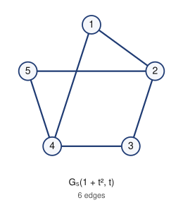<br><b>K₂,₃ = G₅(1 + t², t)</b></td>
<td>

```
g = 1 + t²,  f = t
columns (mod t⁴):  g = 1 + t²,  g·f = t + t³,  g·f² = t²,  g·f³ = t³

B                       A
 1                       0 1 0 1 0
 0 1                     1 0 1 0 1
 1 0 1                   0 1 0 1 0
 0 1 0 1                 1 0 1 0 1
                         0 1 0 1 0
edges: 12 14 23 25 34 45
```
The parts are {2, 4} and {1, 3, 5}.
</td></tr>
<tr><td align="center">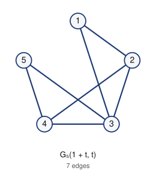<br><b>P₅² = G₅(1 + t, t)</b></td>
<td>

```
g = 1 + t,  f = t
columns (mod t⁴):  g = 1 + t,  g·f = t + t²,  g·f² = t² + t³,  g·f³ = t³

B                       A
 1                       0 1 1 0 0
 1 1                     1 0 1 1 0
 0 1 1                   1 1 0 1 1
 0 0 1 1                 0 1 1 0 1
                         0 0 1 1 0
edges: 12 13 23 24 34 35 45
```
The square of the path: `i ~ j` iff `|i − j| ≤ 2`.
</td></tr>
</table>

The four graphs on five vertices that are **not** Riordan are `C₄ ∪ K₁`, `K₄ ∪ K₁`, and the complements
of the chair and of `K₁,₃ ∪ K₁`. All 30 Riordan graphs are listed in
[examples/unlabeled/order_5.md](examples/unlabeled/order_5.md).

### 4.3 Complements

Taking complements does not preserve the Riordan property. Three situations occur.

**(a) The complement is Riordan with the same labeling.** For graphs of Appell type `G_n(g, t)`, the
complement is `G_n(g + 1/(1−t), t)` (Cheon et al., §2.6).

<table>
<tr><td align="center"><br>K₂,₃ = G₅(1 + t², t)</td>
<td align="center">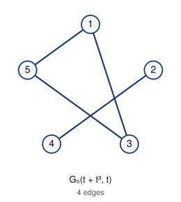<br>complement K₃ ∪ K₂ = G₅(t + t³, t)</td>
<td>

```
complement:  g' = g + 1/(1−t) = t + t³ (mod t⁴),  f' = t

B'
 0
 1 0
 0 1 0
 1 0 1 0
edges: 13 15 24 35
```
</td></tr>
</table>

**(b) The complement is Riordan only after relabeling.** The claw `K₁,₃ = G₄(1 + t + t², 0)` has
complement `K₃ ∪ K₁` on the same vertices, with edges 23 24 34. In that labeling vertex 1 is isolated,
which forces `g = 0`, so it is not a labeled Riordan graph. Renumbering `2→1, 3→2, 1→3, 4→4` gives
`G₄(1 + t², t²)`:

<table>
<tr><td align="center">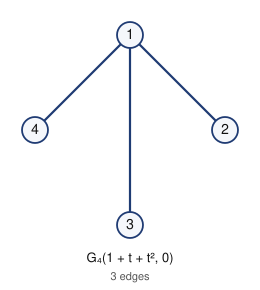<br>K₁,₃ = G₄(1 + t + t², 0)</td>
<td align="center">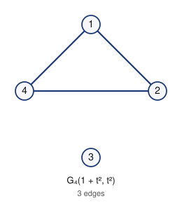<br>K₃ ∪ K₁ = G₄(1 + t², t²)</td>
<td>

```
claw:   B = 1 / 1 0 / 1 0 0         (g = 1 + t + t², f = 0)
K3∪K1:  B = 1 / 0 0 / 1 1 0         (g = 1 + t², f = t²)
```
</td></tr>
</table>

**(c) The complement is not Riordan.** The star `K₁,₄ = G₅(1 + t + t² + t³, 0)` is Riordan, but its
complement `K₄ ∪ K₁` is not (Cheon et al., Prop. 2.13).

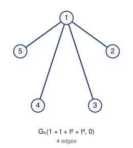

Listings: [examples/complement/](examples/complement/), for orders 4–6 in both the labeled and the
unlabeled sense.

### 4.4 Self-complementary Riordan graphs

A graph is self-complementary if it is isomorphic to its complement. Among Riordan graphs there are
1, 2, 1, 1 of these for `n = 4, 5, 8, 9` (and none for `n = 6, 7`).

<table>
<tr><td align="center">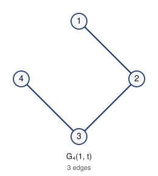<br>P₄ = G₄(1, t)</td>
<td align="center">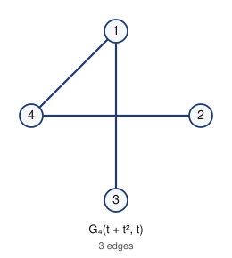<br>complement = G₄(t + t², t)</td>
<td>

```
P4:          B = 1 / 0 1 / 0 0 1          edges 12 23 34
complement:  B = 0 / 1 0 / 1 1 0          edges 13 14 24  (the path 3-1-4-2)
```
The complement is Riordan in the same labeling.
</td></tr>
<tr><td align="center">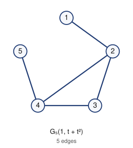<br>bull = G₅(1, t + t²)</td>
<td></td>
<td>

```
g = 1, f = t + t²
B = 1 / 0 1 / 0 1 1 / 0 0 0 1                 edges 12 23 24 34 45
complement edges 13 14 15 25 35. Renumbering 2→1, 5→2, 3→3, 1→4, 4→5
turns it into G5(1, t + t²) again.
```
</td></tr>
<tr><td align="center">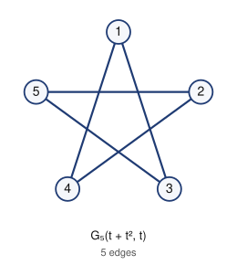<br>C₅ = G₅(t + t², t)</td>
<td align="center">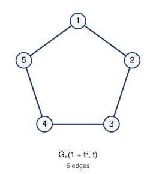<br>complement = G₅(1 + t³, t)</td>
<td>

```
C5:          B = 0 / 1 0 / 1 1 0 / 0 1 1 0    edges 13 14 24 25 35
complement:  B = 1 / 0 1 / 0 0 1 / 1 0 0 1    edges 12 15 23 34 45
```
Both are 5-cycles, and both labelings are Riordan.
</td></tr>
</table>

Listings for `n = 4, 5, 8, 9, 12`: [examples/self_complementary/](examples/self_complementary/).

### 4.5 Complete listings

| folder | content |
|---|---|
| [examples/unlabeled/](examples/unlabeled/) | every unlabeled Riordan graph of order 1–6 (1, 2, 4, 11, 30, 109 graphs) with drawing, `(g, f)`, `B`, edge list, graph6, class size |
| [examples/labeled/](examples/labeled/) | every labeled Riordan graph of order 2–4 (2, 6, 22 graphs) |
| [examples/complement/](examples/complement/) | Riordan graphs whose complement is Riordan, orders 4–6, labeled and unlabeled |
| [examples/self_complementary/](examples/self_complementary/) | self-complementary Riordan graphs, orders 4, 5, 8, 9, 12 |
| [examples/csv/](examples/csv/) | machine-readable lists: unlabeled for orders 1–9, labeled for orders 1–7 |

Each of these listings can be produced for other orders with `rglist`.

## 5. Installation

### Requirements

| | required | notes |
|---|---|---|
| OS | Linux or macOS | on Windows, use WSL 2 |
| C++ compiler | C++20: GCC ≥ 10 or Clang ≥ 13 (Apple Clang ≥ 14) | |
| C compiler | any C99 compiler | builds the bundled nauty |
| build tool | GNU make, POSIX `sh` | |
| optional | Python ≥ 3.8 with `networkx` | only for the reference implementation in `proto/` |

nauty 2.8.8 (B. D. McKay and A. Piperno, Apache 2.0) is bundled in `third_party/nauty`, so nothing
else needs to be installed.

### Build and test

```sh
git clone https://github.com/arnauldmwafise/riordan-graph-enumerator.git
cd riordan-graph-enumerator
make -j4          # builds every tool into build/
make check        # self-tests, about 15 seconds
```

`make check` runs five tests:

* the labeled enumeration (distinctness, and agreement with the recognizer on all labeled graphs
  with `n ≤ 7`);
* `u(1..8)` by all three methods;
* the `rglist` counts;
* statistical checks of `rgsample`.

The expected last line is `rgsample: all checks passed`. The tests are described in
[docs/ARCHITECTURE.md §5](docs/ARCHITECTURE.md#5-tests-make-check).

macOS: `make CXX=clang++ CC=clang`. Other compilers: `make CXX=... CC=...`. Optimization flags:
`make CXXFLAGS="-O3 -march=native"`. To clean up: `make clean`.

## 6. Quick start

```sh
build/rglist 4                          # the 11 unlabeled Riordan graphs of order 4
build/rglist 4 --labeled                # the 22 labeled Riordan graphs of order 4
build/rglist 5 --show "1+t^2" t         # one graph G_5(1+t^2, t) with its matrices
build/rglist 6 --format markdown --svg out > order6.md   # browsable listing with drawings
build/rgcount 12 --threads 4            # u(12): prints "12 1398102 671656  (... s)"
build/tree_count 12 --threads 4         # the same value by the independent method B
build/geng -q 8 | build/recognize_all   # method C: "8 12346 1864 10482"
build/rgsample 40 --samples 5           # five random labeled Riordan graphs of order 40
build/rgsample 12 --model unlabeled --samples 1000 --summary   # uniform unlabeled graphs, statistics
build/rgsample 14 --class-size --samples 1000 --summary        # estimate u(14) (exact: 11481042)
```

## 7. Listing Riordan graphs: `rglist`

```
rglist N [--unlabeled | --labeled] [--filter all|complement|selfcomplementary|connected]
         [--format text|markdown|csv|json] [--svg DIR] [--count]
rglist N --show G F [--format ...] [--svg DIR]
```

| option | meaning |
|---|---|
| `--unlabeled` (default) | one entry per isomorphism class. The representative is the Riordan labeling with the fewest non-zero coefficients in `(g, f)`. The entry also gives the number of labeled Riordan graphs in the class, and whether the complement is Riordan. |
| `--labeled` | every labeled Riordan graph `G_n(g,f)` once (canonical `g mod tⁿ⁻¹`, `f mod tⁿ⁻¹⁻ʳ`) |
| `--filter complement` | only graphs whose complement is Riordan (labeled mode: with the same labeling) |
| `--filter selfcomplementary` | only self-complementary graphs (unlabeled mode) |
| `--filter connected` | only connected graphs |
| `--format` | `text` (default), `markdown`, `csv` (one row per graph), `json` |
| `--svg DIR` | one SVG drawing per graph, vertices placed clockwise in Riordan order |
| `--count` | print only the number of graphs listed |
| `--show G F` | a single graph `G_n(g, f)`; polynomials are written like `"1+t+t^3"` |

Practical limits: unlabeled `n ≤ 14` (the tool enumerates all `L(n)` labeled graphs in memory), and
labeled `n ≤ 16`. For `n ≤ 10` any listing takes under a second.

Example (`build/rglist 4`, the 8th of the 11 entries):

```
[8] G_4(g, f) with g = 1,  f = t + t^2
    edges (4): 12 23 24 34
    degree sequence: 3 2 2 1
    graph6: Cj
    labeled Riordan graphs in this class: 3;  complement Riordan: yes
    Riordan matrix B (rows i = 0..2)      adjacency lower triangle (rows 2..4)
    1              2: 1
    0 1            3: 0 1
    0 1 1          4: 0 1 1
```

`graph6` strings can be read by nauty, SageMath, networkx (`nx.from_graph6_bytes`) and most graph
software.

## 8. Sampling Riordan graphs: `rgsample`

Exhaustive enumeration ends at `n = 17`. To study Riordan graphs of larger order, `rgsample` draws
them at random from exactly specified distributions and summarizes their structure.

```
rgsample N [--samples S] [--seed X] [--model labeled|proper|appell|bell|unlabeled]
           [--fprime 0|1] [--val-g R] [--contains P] [--contains-induced P] [--avoids P]
           [--avoids-induced P] [--connected] [--edges A:B] [--report P]
           [--class-size] [--node-limit L] [--max-attempts M]
           [--format text|csv|json] [--summary] [--svg DIR]
```

**Sampling models**

| model | distribution | order |
|---|---|---|
| `labeled` (default) | uniform over all `L(n)` labeled Riordan graphs (each canonical pair `(g, f)` equally likely) | 2 ≤ n ≤ 64 |
| `proper` | uniform over proper graphs: `g(0) = 1`, `f'(0) = 1` | 2 ≤ n ≤ 64 |
| `appell` | uniform over Appell-type graphs `G_n(g, t)` (Toeplitz graphs) | 2 ≤ n ≤ 64 |
| `bell` | uniform over Bell-type graphs `G_n(g, t·g)` | 2 ≤ n ≤ 64 |
| `unlabeled` | **exactly uniform over unlabeled Riordan graphs** | practical n ≲ 16 (more with `--fprime 1`) |

How `unlabeled` works: a labeled graph `H` is drawn uniformly and accepted with probability
`1/|C(H)|`, where `|C(H)|` is the number of labeled Riordan graphs isomorphic to `H`. That number is
computed exactly by enumerating all Riordan labelings of `H`. Every isomorphism class is therefore
accepted with the same probability `1/L(n)`, and the acceptance rate itself estimates `u(n)/L(n)`.

**Conditioning on structure.** Patterns are names (`K3`, `K4`, `K5`, `P3`, `P4`, `P5`, `C4`, `C5`,
`C6`, `claw`, `star4`, `paw`, `diamond`, `2K2`, `bull`, `house`, `K23`, `chair`, `cochair`, `C4+K1`,
`K4+K1`) or any graph6 string.

| option | condition |
|---|---|
| `--contains P` / `--avoids P` | P occurs / does not occur as a subgraph (repeatable) |
| `--contains-induced P` / `--avoids-induced P` | the same for induced subgraphs |
| `--connected`, `--edges A:B` | connectivity, number of edges |
| `--fprime 0\|1`, `--val-g R` | parameter restrictions: `f'(0)`, lowest power of `t` in `g` |

The filters are isomorphism-invariant, so the samples are uniform on the restricted set in every
model. Each sample is drawn by rejection, and the summary reports the acceptance rate. A rare
structure therefore needs many draws.

**Output.**

* Per sample: `(g, f)`, edges, minimum and maximum degree, triangles, components, diameter, Wiener
  index and graph6.
* With `--class-size`, also `|C(H)|` and whether `C(H) = {H, rev H}`, the reversal pair.
* The summary gives the mean, standard deviation and range of every invariant, and the frequency of
  each `--report` pattern as a subgraph and as an induced subgraph.
* With `--model labeled --class-size` and no filters, it also gives the unbiased estimate
  `u(n) ≈ L(n)·mean(1/|C(H)|)` with a 95 % interval.

Example: `build/rgsample 64 --samples 5000 --summary --report K4`

```
# rgsample n=64 model=labeled seed=1: 5000 samples accepted out of 5000 draws (rate 1.0000)
#   edges                  mean   711.6880   sd  326.6879   min       96   max     1276   (5000 values)
#   maximum degree         mean    37.6698   sd    4.0963   min       22   max       50   (5000 values)
#   triangles              mean  2960.6920   sd 2642.1191   min        7   max    10592   (5000 values)
#   diameter (connected)   mean     2.6236   sd    0.7302   min        2   max        5   (4679 values)
#   connected fraction     0.9358
#   pattern K4         contained as subgraph 0.9632, as induced subgraph 0.9632
```

**Validation against exact values** (details in [docs/COMPUTATIONS.md §5](docs/COMPUTATIONS.md#5-sampling-beyond-the-exhaustive-range-buildrgsample)):

* χ² tests of uniformity over all 86 labeled graphs of order 5 and all 109 unlabeled graphs of
  order 6 are consistent with uniform sampling.
* The unlabeled acceptance rate at n = 8 is 0.3430; the exact value is 1864/5462 = 0.3413.
* The estimate of u(14) is [1.128, 1.212]·10⁷; the exact value is 1.148·10⁷.
* The subgraph filters agree with networkx on 5 232 graphs.

**Limits.**

* Class sizes need a search over Riordan labelings. It is fast for graphs with `f'(0) = 1` (all 100
  sampled at n = 22 have `C(H) = {H, rev H}`).
* For graphs with `f'(0) = 0` and `val f ≥ 3`, the search can exceed `--node-limit` from n ≈ 15 on.
  Such searches are reported, and the u(n) estimate is then widened to a conservative interval.

Showcase runs, regenerated by `scripts/sampling_examples.sh`, are in [data/sampling/](data/sampling/).

## 9. Counting tools

| tool | method | usage | notes |
|---|---|---|---|
| `build/rgcount` | A: enumerate the `L(n)` labeled graphs, nauty canonical form (degree partition), count distinct 128-bit fingerprints | `rgcount N [--threads T] [--passes P] [--checkpoint FILE]` | output `N L(N) u(N) (time)` |
| `build/tree_count` | B: independent vertex-by-vertex generator, nauty with unit partition, different hash | `tree_count N [--threads T] [--passes P] [--checkpoint FILE] [--split D]` | output `N L(N) u(N)` |
| `build/geng` + `build/recognize_all` | C: test every graph of order N for a Riordan labeling | `geng -q N \| recognize_all [--riordan F] [--nonriordan F] [--stats]` | output `N graphs riordan nonriordan` |

* **Passes.** `--passes P` splits the work by an isomorphism invariant, which divides memory by
  about P. Each pass regenerates all labeled graphs.
* **Checkpoints.** `--checkpoint FILE` records finished passes, so an interrupted run resumes where
  it stopped.
* **Built-in check.** Every run checks that it generated exactly `L(n)` labeled graphs.

Approximate cost on one core:

| n | time per method | memory per pass |
|---:|---|---|
| ≤ 13 | under 30 s | small |
| 15 | about 10 min | 0.8 GB |
| 16 | about 45 min | 0.8 GB with 4 passes |
| 17 | about 7 h (12 passes) | 1–2 GB with 12 passes |
| 18 | about 18 h on 2 cores (estimate), a few hours on a 32-core server | 48 passes on 8 GB; fewer passes with more RAM |

Further tools, described in [docs/COMPUTATIONS.md](docs/COMPUTATIONS.md):

* `complement_labeled`, `complement_unlabeled`: complement counts;
* `structure`: minimal non-Riordan graphs and failures of heredity;
* `labelstats`, `labelstats2`: how many Riordan labelings a graph has (for random large graphs, use
  `rgsample --class-size`);
* `bell`: io-decomposable Bell-type graphs.

## 10. Reproducing all results

```sh
make
scripts/compute_counts.sh 1 14        # methods A and B, n = 1..14, writes data/counts.csv (~5 min)
scripts/compute_counts.sh 15 17 8     # n = 15..17 with 8 threads (hours; resumable)
scripts/method_c.sh 9                 # method C for n ≤ 9 (n = 10 takes a few hours)
scripts/make_examples.sh              # regenerate examples/
scripts/sampling_examples.sh          # sampler showcase and validation runs, data/sampling/ (~2 min)
scripts/bell_all64.sh                 # 2^31 io-decomposable graphs of order 64 (hours; resumable)
```

All scripts are idempotent: finished results are kept, and interrupted runs resume from their
checkpoints. The logs of the runs reported here are in `data/runs/`.

## 11. Verification strategy

1. **Two independent exhaustive methods for every value.**
   * Methods A and B share no source code.
   * They generate the labeled graphs in different ways, enumerating parameters versus growing a
     search tree.
   * They use different nauty initial partitions, different 128-bit hash functions and different
     work-splitting invariants.
   * They agree for all `n ≤ 17`, including the per-pass totals.
2. **A third method without canonical forms.** Method C tests every graph from `geng`. For `n ≤ 10`
   its counts agree with A and B, and its totals match the number of graphs (OEIS
   [A000088](https://oeis.org/A000088)).
3. **Built-in invariants.**
   * Every run checks the number of generated labeled graphs against `L(n)`.
   * The class sizes reported by `rglist` add up to `L(n)`.
4. **Reference implementation.** `proto/riordan_graphs_proto.py` is a direct transcription of the
   definition with brute-force isomorphism testing. It reproduces `u(n)` for `n ≤ 7`.
5. **Unit tests.** `make check` runs the tests above. GitHub Actions runs them on every push.

A wrong value of `u(n)` would require A and B to make the *same* error through different code. That
would mean two isomorphism classes colliding under two unrelated hash functions, or both generators
producing the same wrong set of `L(n)` graphs.

## 12. Documentation and repository structure

### Where to find what

| document | content |
|---|---|
| this README | background, motivation, results, worked examples, installation, tool usage |
| [docs/COMPUTATIONS.md](docs/COMPUTATIONS.md) | how every number was computed: methods A/B/C, results with timings, further sequences, sampler validation, cross-checks |
| [docs/ARCHITECTURE.md](docs/ARCHITECTURE.md) | code organisation: conventions, library API (every header), executables with their inputs and outputs, data flow, tests |
| [examples/README.md](examples/README.md) | index of the generated listings (graphs, matrices, drawings, CSV) |
| [data/rigidity/README.md](data/rigidity/README.md) | provenance and format of the class-size samples |
| source files | every file starts with a documentation header (purpose, method, usage, inputs, outputs, cost); every function has a Doxygen comment |
| `Doxyfile` | optional HTML API reference: `doxygen Doxyfile` writes `docs/html/` (needs Doxygen) |

### Repository structure

```
riordan-graph-enumerator/
├── README.md, LICENSE, CITATION.cff, Makefile, Doxyfile, .gitignore
├── include/rgraph/            header-only library (namespace rgraph)
│   ├── riordan_graph.hpp      G_n(g,f) from the definition; canonical parameters; Enumeration of all
│   │                          L(n) labeled Riordan graphs
│   ├── canon.hpp              nauty canonical forms; 128-bit isomorphism-class fingerprints; complement
│   ├── recognize.hpp          labeled recognition (g from column 1, f from column 2); reversal
│   ├── labelings.hpp          all Riordan labelings of an unlabeled graph (exact search) → class C(G)
│   ├── properties.hpp         invariants (edges, components, triangles, diameter, Wiener index);
│   │                          subgraph / induced-subgraph search; named patterns
│   └── io.hpp                 polynomials ↔ text, Riordan matrix, edge lists, graph6, SVG drawings
├── tools/
│   ├── rgcount.cpp            method A: u(n) by enumeration + canonical fingerprints
│   ├── rglist.cpp             listing tool
│   └── rgsample.cpp           sampling tool
├── verify/
│   ├── tree_count.cpp         method B: u(n) by an independent generator
│   └── recognize_all.cpp      method C: decides for every graph (from geng) whether it is Riordan
├── analysis/                  complement_labeled, complement_unlabeled, structure, labelstats,
│                              labelstats2, bell (see docs/COMPUTATIONS.md §4)
├── tests/                     quick_check.cpp, recognize_test.cpp, small_counts.sh, rglist_test.sh,
│                              rgsample_test.sh
├── proto/                     Python reference implementation of the definition (n ≤ 7)
├── scripts/                   compute_counts.sh, method_c.sh, make_examples.sh,
│                              sampling_examples.sh, bell_all64.sh (all resumable)
├── data/
│   ├── counts.csv             u(n) by methods A and B, n ≤ 17
│   ├── runs/                  logs and checkpoints of every counting run
│   ├── lists/                 graph6 lists from method C (Riordan, non-Riordan, minimal), n ≤ 10
│   ├── sampling/              sampler showcase and validation runs
│   ├── rigidity/              class-size samples for f'(0) = 1, n = 18..28
│   └── bell/                  io-decomposable Bell-type graphs (diameters, Wiener index)
├── docs/                      COMPUTATIONS.md, ARCHITECTURE.md, figures/ (README drawings)
├── examples/                  listings generated by rglist (Markdown + SVG, CSV)
├── third_party/nauty/         nauty 2.8.8 (Apache 2.0)
└── .github/workflows/ci.yml   build and tests on Linux and macOS
```

## 13. Citing, license, acknowledgements

If you use this software or data, please cite the repository; see [CITATION.cff](CITATION.cff).

**Author:** Arnauld Mesinga Mwafise.
**License:** MIT ([LICENSE](LICENSE)). nauty is distributed under the Apache License 2.0
([third_party/nauty](third_party/nauty)).

**Acknowledgements.** Canonical labeling and graph generation use nauty and geng by Brendan McKay and
Adolfo Piperno.

**References**

1. G.-S. Cheon, J.-H. Jung, S. Kitaev, S. A. Mojallal, Riordan graphs I: Structural properties,
   *Linear Algebra Appl.* 579 (2019) 89–135.
2. G.-S. Cheon, J.-H. Jung, S. Kitaev, S. A. Mojallal, Riordan graphs II: Spectral properties,
   *Linear Algebra Appl.* 575 (2019) 174–215.
3. L. W. Shapiro, S. Getu, W.-J. Woan, L. C. Woodson, The Riordan group, *Discrete Appl. Math.* 34
   (1991) 229–239.
4. F. Harary, E. M. Palmer, *Graphical Enumeration*, Academic Press, 1973.
5. B. D. McKay, A. Piperno, Practical graph isomorphism, II, *J. Symbolic Comput.* 60 (2014) 94–112.
