# Labeled Riordan graphs of order 5 (filter: complement): 28

## 1. G_5(0, 0)


- edges (0): 
- degree sequence: 0 0 0 0 0
- graph6: `D??`
- complement is a labeled Riordan graph (same labeling): yes

Riordan matrix B = [ [t^i] g f^j ] (rows i = 0..3)      adjacency matrix A (lower triangle, rows 2..5)

```
0                2: 0
0 0              3: 0 0
0 0 0            4: 0 0 0
0 0 0 0          5: 0 0 0 0
```

## 2. G_5(1, t)

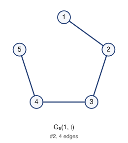

- edges (4): 12 23 34 45
- degree sequence: 2 2 2 1 1
- graph6: `DhC`
- complement is a labeled Riordan graph (same labeling): yes

Riordan matrix B = [ [t^i] g f^j ] (rows i = 0..3)      adjacency matrix A (lower triangle, rows 2..5)

```
1                2: 1
0 1              3: 0 1
0 0 1            4: 0 0 1
0 0 0 1          5: 0 0 0 1
```

## 3. G_5(1 + t, t)

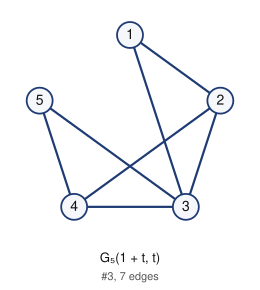

- edges (7): 12 13 23 24 34 35 45
- degree sequence: 4 3 3 2 2
- graph6: `DzK`
- complement is a labeled Riordan graph (same labeling): yes

Riordan matrix B = [ [t^i] g f^j ] (rows i = 0..3)      adjacency matrix A (lower triangle, rows 2..5)

```
1                2: 1
1 1              3: 1 1
0 1 1            4: 0 1 1
0 0 1 1          5: 0 0 1 1
```

## 4. G_5(1 + t^2, t)

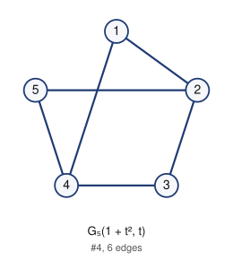

- edges (6): 12 14 23 25 34 45
- degree sequence: 3 3 2 2 2
- graph6: `DlS`
- complement is a labeled Riordan graph (same labeling): yes

Riordan matrix B = [ [t^i] g f^j ] (rows i = 0..3)      adjacency matrix A (lower triangle, rows 2..5)

```
1                2: 1
0 1              3: 0 1
1 0 1            4: 1 0 1
0 1 0 1          5: 0 1 0 1
```

## 5. G_5(1 + t + t^2, t)

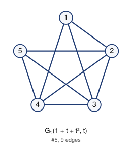

- edges (9): 12 13 14 23 24 25 34 35 45
- degree sequence: 4 4 4 3 3
- graph6: `D~[`
- complement is a labeled Riordan graph (same labeling): yes

Riordan matrix B = [ [t^i] g f^j ] (rows i = 0..3)      adjacency matrix A (lower triangle, rows 2..5)

```
1                2: 1
1 1              3: 1 1
1 1 1            4: 1 1 1
0 1 1 1          5: 0 1 1 1
```

## 6. G_5(1 + t^3, t)

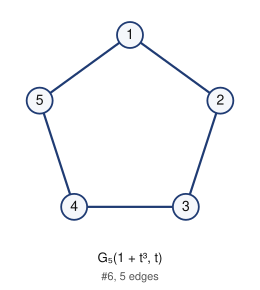

- edges (5): 12 15 23 34 45
- degree sequence: 2 2 2 2 2
- graph6: `Dhc`
- complement is a labeled Riordan graph (same labeling): yes

Riordan matrix B = [ [t^i] g f^j ] (rows i = 0..3)      adjacency matrix A (lower triangle, rows 2..5)

```
1                2: 1
0 1              3: 0 1
0 0 1            4: 0 0 1
1 0 0 1          5: 1 0 0 1
```

## 7. G_5(1 + t + t^3, t)

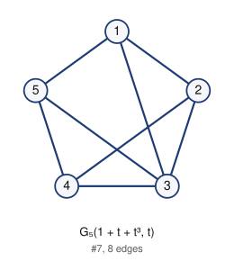

- edges (8): 12 13 15 23 24 34 35 45
- degree sequence: 4 3 3 3 3
- graph6: `Dzk`
- complement is a labeled Riordan graph (same labeling): yes

Riordan matrix B = [ [t^i] g f^j ] (rows i = 0..3)      adjacency matrix A (lower triangle, rows 2..5)

```
1                2: 1
1 1              3: 1 1
0 1 1            4: 0 1 1
1 0 1 1          5: 1 0 1 1
```

## 8. G_5(1 + t^2 + t^3, t)

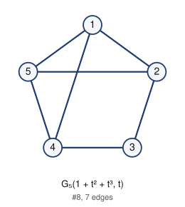

- edges (7): 12 14 15 23 25 34 45
- degree sequence: 3 3 3 3 2
- graph6: `Dls`
- complement is a labeled Riordan graph (same labeling): yes

Riordan matrix B = [ [t^i] g f^j ] (rows i = 0..3)      adjacency matrix A (lower triangle, rows 2..5)

```
1                2: 1
0 1              3: 0 1
1 0 1            4: 1 0 1
1 1 0 1          5: 1 1 0 1
```

## 9. G_5(1 + t + t^2 + t^3, t)

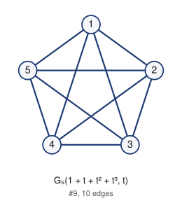

- edges (10): 12 13 14 15 23 24 25 34 35 45
- degree sequence: 4 4 4 4 4
- graph6: `D~{`
- complement is a labeled Riordan graph (same labeling): yes

Riordan matrix B = [ [t^i] g f^j ] (rows i = 0..3)      adjacency matrix A (lower triangle, rows 2..5)

```
1                2: 1
1 1              3: 1 1
1 1 1            4: 1 1 1
1 1 1 1          5: 1 1 1 1
```

## 10. G_5(1, t + t^3)

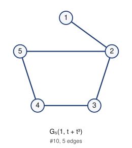

- edges (5): 12 23 25 34 45
- degree sequence: 3 2 2 2 1
- graph6: `DhS`
- complement is a labeled Riordan graph (same labeling): yes

Riordan matrix B = [ [t^i] g f^j ] (rows i = 0..3)      adjacency matrix A (lower triangle, rows 2..5)

```
1                2: 1
0 1              3: 0 1
0 0 1            4: 0 0 1
0 1 0 1          5: 0 1 0 1
```

## 11. G_5(1 + t, t + t^3)

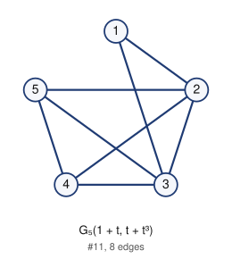

- edges (8): 12 13 23 24 25 34 35 45
- degree sequence: 4 4 3 3 2
- graph6: `Dz[`
- complement is a labeled Riordan graph (same labeling): yes

Riordan matrix B = [ [t^i] g f^j ] (rows i = 0..3)      adjacency matrix A (lower triangle, rows 2..5)

```
1                2: 1
1 1              3: 1 1
0 1 1            4: 0 1 1
0 1 1 1          5: 0 1 1 1
```

## 12. G_5(1 + t^2, t + t^3)

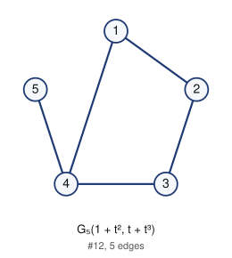

- edges (5): 12 14 23 34 45
- degree sequence: 3 2 2 2 1
- graph6: `DlC`
- complement is a labeled Riordan graph (same labeling): yes

Riordan matrix B = [ [t^i] g f^j ] (rows i = 0..3)      adjacency matrix A (lower triangle, rows 2..5)

```
1                2: 1
0 1              3: 0 1
1 0 1            4: 1 0 1
0 0 0 1          5: 0 0 0 1
```

## 13. G_5(1 + t^3, t + t^3)

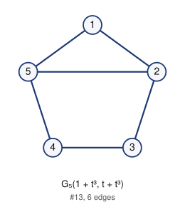

- edges (6): 12 15 23 25 34 45
- degree sequence: 3 3 2 2 2
- graph6: `Dhs`
- complement is a labeled Riordan graph (same labeling): yes

Riordan matrix B = [ [t^i] g f^j ] (rows i = 0..3)      adjacency matrix A (lower triangle, rows 2..5)

```
1                2: 1
0 1              3: 0 1
0 0 1            4: 0 0 1
1 1 0 1          5: 1 1 0 1
```

## 14. G_5(1 + t + t^3, t + t^3)

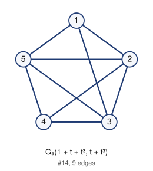

- edges (9): 12 13 15 23 24 25 34 35 45
- degree sequence: 4 4 4 3 3
- graph6: `Dz{`
- complement is a labeled Riordan graph (same labeling): yes

Riordan matrix B = [ [t^i] g f^j ] (rows i = 0..3)      adjacency matrix A (lower triangle, rows 2..5)

```
1                2: 1
1 1              3: 1 1
0 1 1            4: 0 1 1
1 1 1 1          5: 1 1 1 1
```

## 15. G_5(1 + t^2 + t^3, t + t^3)

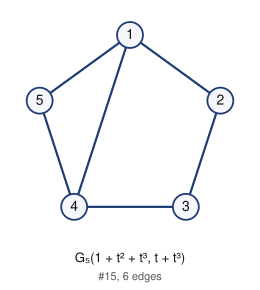

- edges (6): 12 14 15 23 34 45
- degree sequence: 3 3 2 2 2
- graph6: `Dlc`
- complement is a labeled Riordan graph (same labeling): yes

Riordan matrix B = [ [t^i] g f^j ] (rows i = 0..3)      adjacency matrix A (lower triangle, rows 2..5)

```
1                2: 1
0 1              3: 0 1
1 0 1            4: 1 0 1
1 0 0 1          5: 1 0 0 1
```

## 16. G_5(t, t)

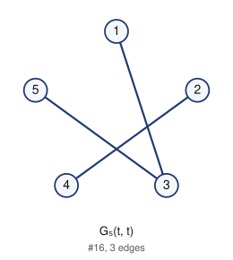

- edges (3): 13 24 35
- degree sequence: 2 1 1 1 1
- graph6: `DQG`
- complement is a labeled Riordan graph (same labeling): yes

Riordan matrix B = [ [t^i] g f^j ] (rows i = 0..3)      adjacency matrix A (lower triangle, rows 2..5)

```
0                2: 0
1 0              3: 1 0
0 1 0            4: 0 1 0
0 0 1 0          5: 0 0 1 0
```

## 17. G_5(t + t^2, t)

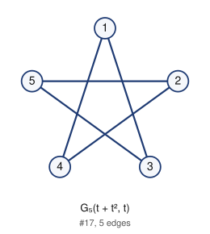

- edges (5): 13 14 24 25 35
- degree sequence: 2 2 2 2 2
- graph6: `DUW`
- complement is a labeled Riordan graph (same labeling): yes

Riordan matrix B = [ [t^i] g f^j ] (rows i = 0..3)      adjacency matrix A (lower triangle, rows 2..5)

```
0                2: 0
1 0              3: 1 0
1 1 0            4: 1 1 0
0 1 1 0          5: 0 1 1 0
```

## 18. G_5(t + t^3, t)

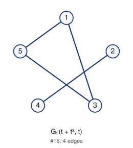

- edges (4): 13 15 24 35
- degree sequence: 2 2 2 1 1
- graph6: `DQg`
- complement is a labeled Riordan graph (same labeling): yes

Riordan matrix B = [ [t^i] g f^j ] (rows i = 0..3)      adjacency matrix A (lower triangle, rows 2..5)

```
0                2: 0
1 0              3: 1 0
0 1 0            4: 0 1 0
1 0 1 0          5: 1 0 1 0
```

## 19. G_5(t + t^2 + t^3, t)

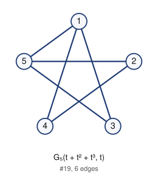

- edges (6): 13 14 15 24 25 35
- degree sequence: 3 3 2 2 2
- graph6: `DUw`
- complement is a labeled Riordan graph (same labeling): yes

Riordan matrix B = [ [t^i] g f^j ] (rows i = 0..3)      adjacency matrix A (lower triangle, rows 2..5)

```
0                2: 0
1 0              3: 1 0
1 1 0            4: 1 1 0
1 1 1 0          5: 1 1 1 0
```

## 20. G_5(t, t + t^2)

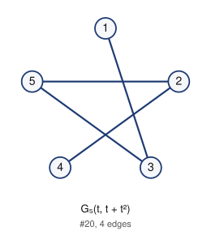

- edges (4): 13 24 25 35
- degree sequence: 2 2 2 1 1
- graph6: `DQW`
- complement is a labeled Riordan graph (same labeling): yes

Riordan matrix B = [ [t^i] g f^j ] (rows i = 0..3)      adjacency matrix A (lower triangle, rows 2..5)

```
0                2: 0
1 0              3: 1 0
0 1 0            4: 0 1 0
0 1 1 0          5: 0 1 1 0
```

## 21. G_5(t + t^2, t + t^2)

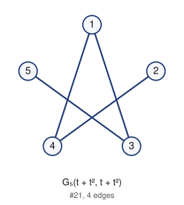

- edges (4): 13 14 24 35
- degree sequence: 2 2 2 1 1
- graph6: `DUG`
- complement is a labeled Riordan graph (same labeling): yes

Riordan matrix B = [ [t^i] g f^j ] (rows i = 0..3)      adjacency matrix A (lower triangle, rows 2..5)

```
0                2: 0
1 0              3: 1 0
1 1 0            4: 1 1 0
0 0 1 0          5: 0 0 1 0
```

## 22. G_5(t + t^3, t + t^2)

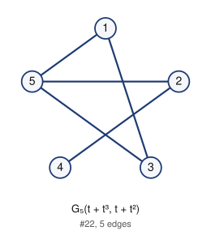

- edges (5): 13 15 24 25 35
- degree sequence: 3 2 2 2 1
- graph6: `DQw`
- complement is a labeled Riordan graph (same labeling): yes

Riordan matrix B = [ [t^i] g f^j ] (rows i = 0..3)      adjacency matrix A (lower triangle, rows 2..5)

```
0                2: 0
1 0              3: 1 0
0 1 0            4: 0 1 0
1 1 1 0          5: 1 1 1 0
```

## 23. G_5(t + t^2 + t^3, t + t^2)

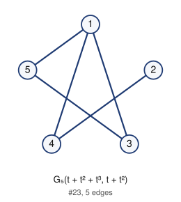

- edges (5): 13 14 15 24 35
- degree sequence: 3 2 2 2 1
- graph6: `DUg`
- complement is a labeled Riordan graph (same labeling): yes

Riordan matrix B = [ [t^i] g f^j ] (rows i = 0..3)      adjacency matrix A (lower triangle, rows 2..5)

```
0                2: 0
1 0              3: 1 0
1 1 0            4: 1 1 0
1 0 1 0          5: 1 0 1 0
```

## 24. G_5(t^2, 0)

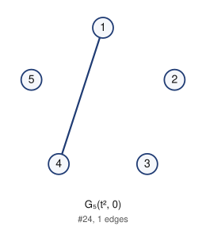

- edges (1): 14
- degree sequence: 1 1 0 0 0
- graph6: `DC?`
- complement is a labeled Riordan graph (same labeling): yes

Riordan matrix B = [ [t^i] g f^j ] (rows i = 0..3)      adjacency matrix A (lower triangle, rows 2..5)

```
0                2: 0
0 0              3: 0 0
1 0 0            4: 1 0 0
0 0 0 0          5: 0 0 0 0
```

## 25. G_5(t^2 + t^3, 0)

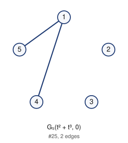

- edges (2): 14 15
- degree sequence: 2 1 1 0 0
- graph6: `DC_`
- complement is a labeled Riordan graph (same labeling): yes

Riordan matrix B = [ [t^i] g f^j ] (rows i = 0..3)      adjacency matrix A (lower triangle, rows 2..5)

```
0                2: 0
0 0              3: 0 0
1 0 0            4: 1 0 0
1 0 0 0          5: 1 0 0 0
```

## 26. G_5(t^2, t)

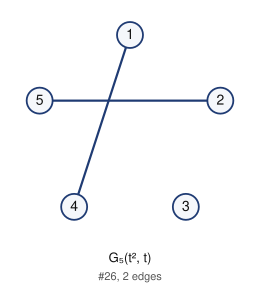

- edges (2): 14 25
- degree sequence: 1 1 1 1 0
- graph6: `DCO`
- complement is a labeled Riordan graph (same labeling): yes

Riordan matrix B = [ [t^i] g f^j ] (rows i = 0..3)      adjacency matrix A (lower triangle, rows 2..5)

```
0                2: 0
0 0              3: 0 0
1 0 0            4: 1 0 0
0 1 0 0          5: 0 1 0 0
```

## 27. G_5(t^2 + t^3, t)

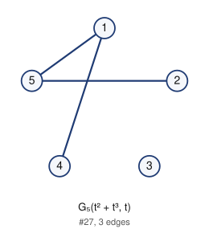

- edges (3): 14 15 25
- degree sequence: 2 2 1 1 0
- graph6: `DCo`
- complement is a labeled Riordan graph (same labeling): yes

Riordan matrix B = [ [t^i] g f^j ] (rows i = 0..3)      adjacency matrix A (lower triangle, rows 2..5)

```
0                2: 0
0 0              3: 0 0
1 0 0            4: 1 0 0
1 1 0 0          5: 1 1 0 0
```

## 28. G_5(t^3, 0)

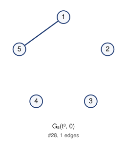

- edges (1): 15
- degree sequence: 1 1 0 0 0
- graph6: `D?_`
- complement is a labeled Riordan graph (same labeling): yes

Riordan matrix B = [ [t^i] g f^j ] (rows i = 0..3)      adjacency matrix A (lower triangle, rows 2..5)

```
0                2: 0
0 0              3: 0 0
0 0 0            4: 0 0 0
1 0 0 0          5: 1 0 0 0
```

