# Labeled Riordan graphs of order 6 (filter: complement): 92

## 1. G_6(0, 0)

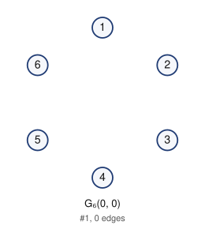

- edges (0): 
- degree sequence: 0 0 0 0 0 0
- graph6: `E???`
- complement is a labeled Riordan graph (same labeling): yes

Riordan matrix B = [ [t^i] g f^j ] (rows i = 0..4)      adjacency matrix A (lower triangle, rows 2..6)

```
0                  2: 0
0 0                3: 0 0
0 0 0              4: 0 0 0
0 0 0 0            5: 0 0 0 0
0 0 0 0 0          6: 0 0 0 0 0
```

## 2. G_6(1, t)

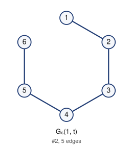

- edges (5): 12 23 34 45 56
- degree sequence: 2 2 2 2 1 1
- graph6: `EhCG`
- complement is a labeled Riordan graph (same labeling): yes

Riordan matrix B = [ [t^i] g f^j ] (rows i = 0..4)      adjacency matrix A (lower triangle, rows 2..6)

```
1                  2: 1
0 1                3: 0 1
0 0 1              4: 0 0 1
0 0 0 1            5: 0 0 0 1
0 0 0 0 1          6: 0 0 0 0 1
```

## 3. G_6(1 + t, t)

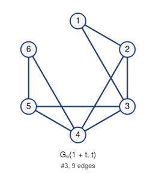

- edges (9): 12 13 23 24 34 35 45 46 56
- degree sequence: 4 4 3 3 2 2
- graph6: `EzKW`
- complement is a labeled Riordan graph (same labeling): yes

Riordan matrix B = [ [t^i] g f^j ] (rows i = 0..4)      adjacency matrix A (lower triangle, rows 2..6)

```
1                  2: 1
1 1                3: 1 1
0 1 1              4: 0 1 1
0 0 1 1            5: 0 0 1 1
0 0 0 1 1          6: 0 0 0 1 1
```

## 4. G_6(1 + t^2, t)

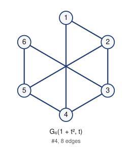

- edges (8): 12 14 23 25 34 36 45 56
- degree sequence: 3 3 3 3 2 2
- graph6: `ElSg`
- complement is a labeled Riordan graph (same labeling): yes

Riordan matrix B = [ [t^i] g f^j ] (rows i = 0..4)      adjacency matrix A (lower triangle, rows 2..6)

```
1                  2: 1
0 1                3: 0 1
1 0 1              4: 1 0 1
0 1 0 1            5: 0 1 0 1
0 0 1 0 1          6: 0 0 1 0 1
```

## 5. G_6(1 + t + t^2, t)

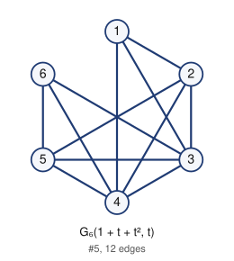

- edges (12): 12 13 14 23 24 25 34 35 36 45 46 56
- degree sequence: 5 5 4 4 3 3
- graph6: `E~[w`
- complement is a labeled Riordan graph (same labeling): yes

Riordan matrix B = [ [t^i] g f^j ] (rows i = 0..4)      adjacency matrix A (lower triangle, rows 2..6)

```
1                  2: 1
1 1                3: 1 1
1 1 1              4: 1 1 1
0 1 1 1            5: 0 1 1 1
0 0 1 1 1          6: 0 0 1 1 1
```

## 6. G_6(1 + t^3, t)

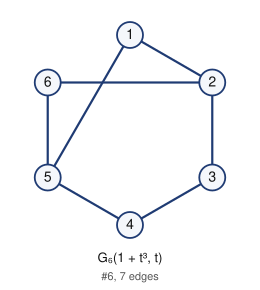

- edges (7): 12 15 23 26 34 45 56
- degree sequence: 3 3 2 2 2 2
- graph6: `EhdG`
- complement is a labeled Riordan graph (same labeling): yes

Riordan matrix B = [ [t^i] g f^j ] (rows i = 0..4)      adjacency matrix A (lower triangle, rows 2..6)

```
1                  2: 1
0 1                3: 0 1
0 0 1              4: 0 0 1
1 0 0 1            5: 1 0 0 1
0 1 0 0 1          6: 0 1 0 0 1
```

## 7. G_6(1 + t + t^3, t)

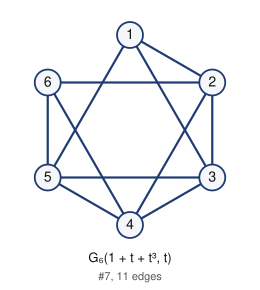

- edges (11): 12 13 15 23 24 26 34 35 45 46 56
- degree sequence: 4 4 4 4 3 3
- graph6: `EzlW`
- complement is a labeled Riordan graph (same labeling): yes

Riordan matrix B = [ [t^i] g f^j ] (rows i = 0..4)      adjacency matrix A (lower triangle, rows 2..6)

```
1                  2: 1
1 1                3: 1 1
0 1 1              4: 0 1 1
1 0 1 1            5: 1 0 1 1
0 1 0 1 1          6: 0 1 0 1 1
```

## 8. G_6(1 + t^2 + t^3, t)

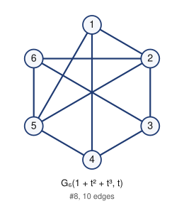

- edges (10): 12 14 15 23 25 26 34 36 45 56
- degree sequence: 4 4 3 3 3 3
- graph6: `Eltg`
- complement is a labeled Riordan graph (same labeling): yes

Riordan matrix B = [ [t^i] g f^j ] (rows i = 0..4)      adjacency matrix A (lower triangle, rows 2..6)

```
1                  2: 1
0 1                3: 0 1
1 0 1              4: 1 0 1
1 1 0 1            5: 1 1 0 1
0 1 1 0 1          6: 0 1 1 0 1
```

## 9. G_6(1 + t + t^2 + t^3, t)

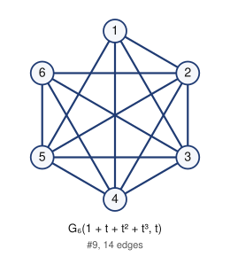

- edges (14): 12 13 14 15 23 24 25 26 34 35 36 45 46 56
- degree sequence: 5 5 5 5 4 4
- graph6: `E~|w`
- complement is a labeled Riordan graph (same labeling): yes

Riordan matrix B = [ [t^i] g f^j ] (rows i = 0..4)      adjacency matrix A (lower triangle, rows 2..6)

```
1                  2: 1
1 1                3: 1 1
1 1 1              4: 1 1 1
1 1 1 1            5: 1 1 1 1
0 1 1 1 1          6: 0 1 1 1 1
```

## 10. G_6(1 + t^4, t)

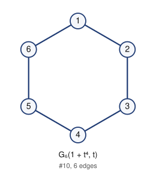

- edges (6): 12 16 23 34 45 56
- degree sequence: 2 2 2 2 2 2
- graph6: `EhEG`
- complement is a labeled Riordan graph (same labeling): yes

Riordan matrix B = [ [t^i] g f^j ] (rows i = 0..4)      adjacency matrix A (lower triangle, rows 2..6)

```
1                  2: 1
0 1                3: 0 1
0 0 1              4: 0 0 1
0 0 0 1            5: 0 0 0 1
1 0 0 0 1          6: 1 0 0 0 1
```

## 11. G_6(1 + t + t^4, t)

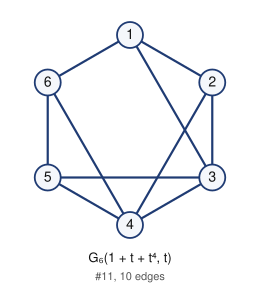

- edges (10): 12 13 16 23 24 34 35 45 46 56
- degree sequence: 4 4 3 3 3 3
- graph6: `EzMW`
- complement is a labeled Riordan graph (same labeling): yes

Riordan matrix B = [ [t^i] g f^j ] (rows i = 0..4)      adjacency matrix A (lower triangle, rows 2..6)

```
1                  2: 1
1 1                3: 1 1
0 1 1              4: 0 1 1
0 0 1 1            5: 0 0 1 1
1 0 0 1 1          6: 1 0 0 1 1
```

## 12. G_6(1 + t^2 + t^4, t)

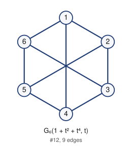

- edges (9): 12 14 16 23 25 34 36 45 56
- degree sequence: 3 3 3 3 3 3
- graph6: `ElUg`
- complement is a labeled Riordan graph (same labeling): yes

Riordan matrix B = [ [t^i] g f^j ] (rows i = 0..4)      adjacency matrix A (lower triangle, rows 2..6)

```
1                  2: 1
0 1                3: 0 1
1 0 1              4: 1 0 1
0 1 0 1            5: 0 1 0 1
1 0 1 0 1          6: 1 0 1 0 1
```

## 13. G_6(1 + t + t^2 + t^4, t)

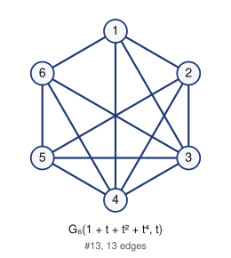

- edges (13): 12 13 14 16 23 24 25 34 35 36 45 46 56
- degree sequence: 5 5 4 4 4 4
- graph6: `E~]w`
- complement is a labeled Riordan graph (same labeling): yes

Riordan matrix B = [ [t^i] g f^j ] (rows i = 0..4)      adjacency matrix A (lower triangle, rows 2..6)

```
1                  2: 1
1 1                3: 1 1
1 1 1              4: 1 1 1
0 1 1 1            5: 0 1 1 1
1 0 1 1 1          6: 1 0 1 1 1
```

## 14. G_6(1 + t^3 + t^4, t)

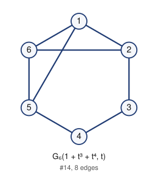

- edges (8): 12 15 16 23 26 34 45 56
- degree sequence: 3 3 3 3 2 2
- graph6: `EhfG`
- complement is a labeled Riordan graph (same labeling): yes

Riordan matrix B = [ [t^i] g f^j ] (rows i = 0..4)      adjacency matrix A (lower triangle, rows 2..6)

```
1                  2: 1
0 1                3: 0 1
0 0 1              4: 0 0 1
1 0 0 1            5: 1 0 0 1
1 1 0 0 1          6: 1 1 0 0 1
```

## 15. G_6(1 + t + t^3 + t^4, t)

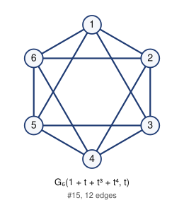

- edges (12): 12 13 15 16 23 24 26 34 35 45 46 56
- degree sequence: 4 4 4 4 4 4
- graph6: `EznW`
- complement is a labeled Riordan graph (same labeling): yes

Riordan matrix B = [ [t^i] g f^j ] (rows i = 0..4)      adjacency matrix A (lower triangle, rows 2..6)

```
1                  2: 1
1 1                3: 1 1
0 1 1              4: 0 1 1
1 0 1 1            5: 1 0 1 1
1 1 0 1 1          6: 1 1 0 1 1
```

## 16. G_6(1 + t^2 + t^3 + t^4, t)

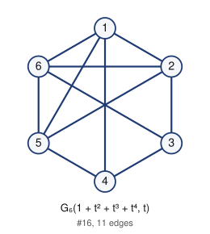

- edges (11): 12 14 15 16 23 25 26 34 36 45 56
- degree sequence: 4 4 4 4 3 3
- graph6: `Elvg`
- complement is a labeled Riordan graph (same labeling): yes

Riordan matrix B = [ [t^i] g f^j ] (rows i = 0..4)      adjacency matrix A (lower triangle, rows 2..6)

```
1                  2: 1
0 1                3: 0 1
1 0 1              4: 1 0 1
1 1 0 1            5: 1 1 0 1
1 1 1 0 1          6: 1 1 1 0 1
```

## 17. G_6(1 + t + t^2 + t^3 + t^4, t)

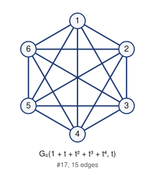

- edges (15): 12 13 14 15 16 23 24 25 26 34 35 36 45 46 56
- degree sequence: 5 5 5 5 5 5
- graph6: `E~~w`
- complement is a labeled Riordan graph (same labeling): yes

Riordan matrix B = [ [t^i] g f^j ] (rows i = 0..4)      adjacency matrix A (lower triangle, rows 2..6)

```
1                  2: 1
1 1                3: 1 1
1 1 1              4: 1 1 1
1 1 1 1            5: 1 1 1 1
1 1 1 1 1          6: 1 1 1 1 1
```

## 18. G_6(1, t + t^3)

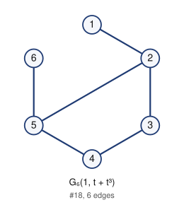

- edges (6): 12 23 25 34 45 56
- degree sequence: 3 3 2 2 1 1
- graph6: `EhSG`
- complement is a labeled Riordan graph (same labeling): yes

Riordan matrix B = [ [t^i] g f^j ] (rows i = 0..4)      adjacency matrix A (lower triangle, rows 2..6)

```
1                  2: 1
0 1                3: 0 1
0 0 1              4: 0 0 1
0 1 0 1            5: 0 1 0 1
0 0 0 0 1          6: 0 0 0 0 1
```

## 19. G_6(1 + t^2, t + t^3)

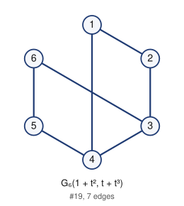

- edges (7): 12 14 23 34 36 45 56
- degree sequence: 3 3 2 2 2 2
- graph6: `ElCg`
- complement is a labeled Riordan graph (same labeling): yes

Riordan matrix B = [ [t^i] g f^j ] (rows i = 0..4)      adjacency matrix A (lower triangle, rows 2..6)

```
1                  2: 1
0 1                3: 0 1
1 0 1              4: 1 0 1
0 0 0 1            5: 0 0 0 1
0 0 1 0 1          6: 0 0 1 0 1
```

## 20. G_6(1 + t^3, t + t^3)

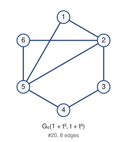

- edges (8): 12 15 23 25 26 34 45 56
- degree sequence: 4 4 2 2 2 2
- graph6: `EhtG`
- complement is a labeled Riordan graph (same labeling): yes

Riordan matrix B = [ [t^i] g f^j ] (rows i = 0..4)      adjacency matrix A (lower triangle, rows 2..6)

```
1                  2: 1
0 1                3: 0 1
0 0 1              4: 0 0 1
1 1 0 1            5: 1 1 0 1
0 1 0 0 1          6: 0 1 0 0 1
```

## 21. G_6(1 + t^2 + t^3, t + t^3)

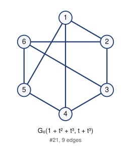

- edges (9): 12 14 15 23 26 34 36 45 56
- degree sequence: 3 3 3 3 3 3
- graph6: `Eldg`
- complement is a labeled Riordan graph (same labeling): yes

Riordan matrix B = [ [t^i] g f^j ] (rows i = 0..4)      adjacency matrix A (lower triangle, rows 2..6)

```
1                  2: 1
0 1                3: 0 1
1 0 1              4: 1 0 1
1 0 0 1            5: 1 0 0 1
0 1 1 0 1          6: 0 1 1 0 1
```

## 22. G_6(1 + t^4, t + t^3)

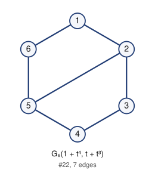

- edges (7): 12 16 23 25 34 45 56
- degree sequence: 3 3 2 2 2 2
- graph6: `EhUG`
- complement is a labeled Riordan graph (same labeling): yes

Riordan matrix B = [ [t^i] g f^j ] (rows i = 0..4)      adjacency matrix A (lower triangle, rows 2..6)

```
1                  2: 1
0 1                3: 0 1
0 0 1              4: 0 0 1
0 1 0 1            5: 0 1 0 1
1 0 0 0 1          6: 1 0 0 0 1
```

## 23. G_6(1 + t^2 + t^4, t + t^3)

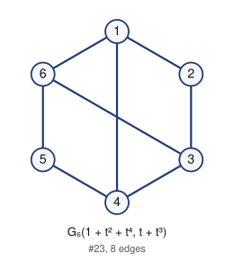

- edges (8): 12 14 16 23 34 36 45 56
- degree sequence: 3 3 3 3 2 2
- graph6: `ElEg`
- complement is a labeled Riordan graph (same labeling): yes

Riordan matrix B = [ [t^i] g f^j ] (rows i = 0..4)      adjacency matrix A (lower triangle, rows 2..6)

```
1                  2: 1
0 1                3: 0 1
1 0 1              4: 1 0 1
0 0 0 1            5: 0 0 0 1
1 0 1 0 1          6: 1 0 1 0 1
```

## 24. G_6(1 + t^3 + t^4, t + t^3)

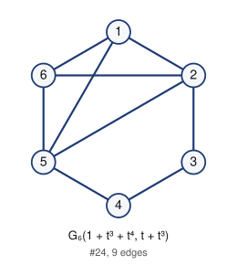

- edges (9): 12 15 16 23 25 26 34 45 56
- degree sequence: 4 4 3 3 2 2
- graph6: `EhvG`
- complement is a labeled Riordan graph (same labeling): yes

Riordan matrix B = [ [t^i] g f^j ] (rows i = 0..4)      adjacency matrix A (lower triangle, rows 2..6)

```
1                  2: 1
0 1                3: 0 1
0 0 1              4: 0 0 1
1 1 0 1            5: 1 1 0 1
1 1 0 0 1          6: 1 1 0 0 1
```

## 25. G_6(1 + t^2 + t^3 + t^4, t + t^3)

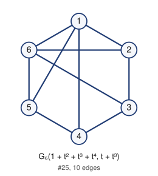

- edges (10): 12 14 15 16 23 26 34 36 45 56
- degree sequence: 4 4 3 3 3 3
- graph6: `Elfg`
- complement is a labeled Riordan graph (same labeling): yes

Riordan matrix B = [ [t^i] g f^j ] (rows i = 0..4)      adjacency matrix A (lower triangle, rows 2..6)

```
1                  2: 1
0 1                3: 0 1
1 0 1              4: 1 0 1
1 0 0 1            5: 1 0 0 1
1 1 1 0 1          6: 1 1 1 0 1
```

## 26. G_6(1, t + t^4)


- edges (6): 12 23 26 34 45 56
- degree sequence: 3 2 2 2 2 1
- graph6: `EhDG`
- complement is a labeled Riordan graph (same labeling): yes

Riordan matrix B = [ [t^i] g f^j ] (rows i = 0..4)      adjacency matrix A (lower triangle, rows 2..6)

```
1                  2: 1
0 1                3: 0 1
0 0 1              4: 0 0 1
0 0 0 1            5: 0 0 0 1
0 1 0 0 1          6: 0 1 0 0 1
```

## 27. G_6(1 + t, t + t^4)

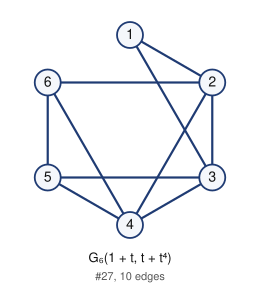

- edges (10): 12 13 23 24 26 34 35 45 46 56
- degree sequence: 4 4 4 3 3 2
- graph6: `EzLW`
- complement is a labeled Riordan graph (same labeling): yes

Riordan matrix B = [ [t^i] g f^j ] (rows i = 0..4)      adjacency matrix A (lower triangle, rows 2..6)

```
1                  2: 1
1 1                3: 1 1
0 1 1              4: 0 1 1
0 0 1 1            5: 0 0 1 1
0 1 0 1 1          6: 0 1 0 1 1
```

## 28. G_6(1 + t^2, t + t^4)

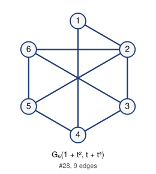

- edges (9): 12 14 23 25 26 34 36 45 56
- degree sequence: 4 3 3 3 3 2
- graph6: `ElTg`
- complement is a labeled Riordan graph (same labeling): yes

Riordan matrix B = [ [t^i] g f^j ] (rows i = 0..4)      adjacency matrix A (lower triangle, rows 2..6)

```
1                  2: 1
0 1                3: 0 1
1 0 1              4: 1 0 1
0 1 0 1            5: 0 1 0 1
0 1 1 0 1          6: 0 1 1 0 1
```

## 29. G_6(1 + t + t^2, t + t^4)

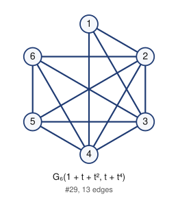

- edges (13): 12 13 14 23 24 25 26 34 35 36 45 46 56
- degree sequence: 5 5 5 4 4 3
- graph6: `E~\w`
- complement is a labeled Riordan graph (same labeling): yes

Riordan matrix B = [ [t^i] g f^j ] (rows i = 0..4)      adjacency matrix A (lower triangle, rows 2..6)

```
1                  2: 1
1 1                3: 1 1
1 1 1              4: 1 1 1
0 1 1 1            5: 0 1 1 1
0 1 1 1 1          6: 0 1 1 1 1
```

## 30. G_6(1 + t^3, t + t^4)

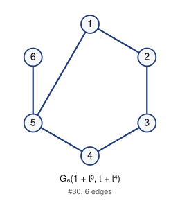

- edges (6): 12 15 23 34 45 56
- degree sequence: 3 2 2 2 2 1
- graph6: `EhcG`
- complement is a labeled Riordan graph (same labeling): yes

Riordan matrix B = [ [t^i] g f^j ] (rows i = 0..4)      adjacency matrix A (lower triangle, rows 2..6)

```
1                  2: 1
0 1                3: 0 1
0 0 1              4: 0 0 1
1 0 0 1            5: 1 0 0 1
0 0 0 0 1          6: 0 0 0 0 1
```

## 31. G_6(1 + t + t^3, t + t^4)

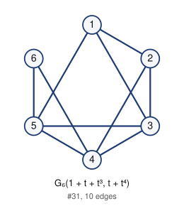

- edges (10): 12 13 15 23 24 34 35 45 46 56
- degree sequence: 4 4 4 3 3 2
- graph6: `EzkW`
- complement is a labeled Riordan graph (same labeling): yes

Riordan matrix B = [ [t^i] g f^j ] (rows i = 0..4)      adjacency matrix A (lower triangle, rows 2..6)

```
1                  2: 1
1 1                3: 1 1
0 1 1              4: 0 1 1
1 0 1 1            5: 1 0 1 1
0 0 0 1 1          6: 0 0 0 1 1
```

## 32. G_6(1 + t^2 + t^3, t + t^4)

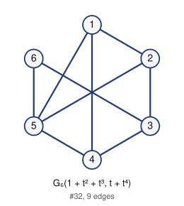

- edges (9): 12 14 15 23 25 34 36 45 56
- degree sequence: 4 3 3 3 3 2
- graph6: `Elsg`
- complement is a labeled Riordan graph (same labeling): yes

Riordan matrix B = [ [t^i] g f^j ] (rows i = 0..4)      adjacency matrix A (lower triangle, rows 2..6)

```
1                  2: 1
0 1                3: 0 1
1 0 1              4: 1 0 1
1 1 0 1            5: 1 1 0 1
0 0 1 0 1          6: 0 0 1 0 1
```

## 33. G_6(1 + t^4, t + t^4)

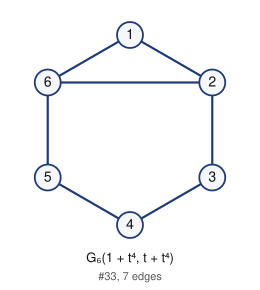

- edges (7): 12 16 23 26 34 45 56
- degree sequence: 3 3 2 2 2 2
- graph6: `EhFG`
- complement is a labeled Riordan graph (same labeling): yes

Riordan matrix B = [ [t^i] g f^j ] (rows i = 0..4)      adjacency matrix A (lower triangle, rows 2..6)

```
1                  2: 1
0 1                3: 0 1
0 0 1              4: 0 0 1
0 0 0 1            5: 0 0 0 1
1 1 0 0 1          6: 1 1 0 0 1
```

## 34. G_6(1 + t + t^4, t + t^4)

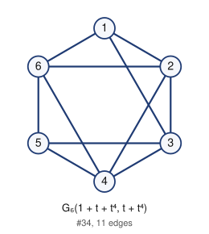

- edges (11): 12 13 16 23 24 26 34 35 45 46 56
- degree sequence: 4 4 4 4 3 3
- graph6: `EzNW`
- complement is a labeled Riordan graph (same labeling): yes

Riordan matrix B = [ [t^i] g f^j ] (rows i = 0..4)      adjacency matrix A (lower triangle, rows 2..6)

```
1                  2: 1
1 1                3: 1 1
0 1 1              4: 0 1 1
0 0 1 1            5: 0 0 1 1
1 1 0 1 1          6: 1 1 0 1 1
```

## 35. G_6(1 + t^2 + t^4, t + t^4)

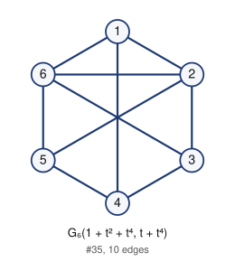

- edges (10): 12 14 16 23 25 26 34 36 45 56
- degree sequence: 4 4 3 3 3 3
- graph6: `ElVg`
- complement is a labeled Riordan graph (same labeling): yes

Riordan matrix B = [ [t^i] g f^j ] (rows i = 0..4)      adjacency matrix A (lower triangle, rows 2..6)

```
1                  2: 1
0 1                3: 0 1
1 0 1              4: 1 0 1
0 1 0 1            5: 0 1 0 1
1 1 1 0 1          6: 1 1 1 0 1
```

## 36. G_6(1 + t + t^2 + t^4, t + t^4)

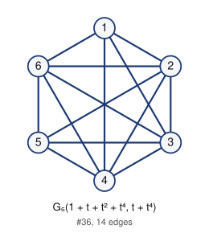

- edges (14): 12 13 14 16 23 24 25 26 34 35 36 45 46 56
- degree sequence: 5 5 5 5 4 4
- graph6: `E~^w`
- complement is a labeled Riordan graph (same labeling): yes

Riordan matrix B = [ [t^i] g f^j ] (rows i = 0..4)      adjacency matrix A (lower triangle, rows 2..6)

```
1                  2: 1
1 1                3: 1 1
1 1 1              4: 1 1 1
0 1 1 1            5: 0 1 1 1
1 1 1 1 1          6: 1 1 1 1 1
```

## 37. G_6(1 + t^3 + t^4, t + t^4)

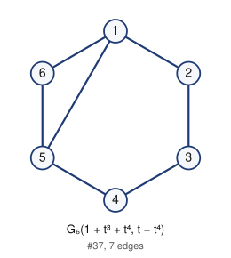

- edges (7): 12 15 16 23 34 45 56
- degree sequence: 3 3 2 2 2 2
- graph6: `EheG`
- complement is a labeled Riordan graph (same labeling): yes

Riordan matrix B = [ [t^i] g f^j ] (rows i = 0..4)      adjacency matrix A (lower triangle, rows 2..6)

```
1                  2: 1
0 1                3: 0 1
0 0 1              4: 0 0 1
1 0 0 1            5: 1 0 0 1
1 0 0 0 1          6: 1 0 0 0 1
```

## 38. G_6(1 + t + t^3 + t^4, t + t^4)

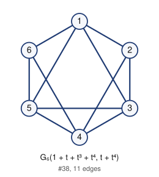

- edges (11): 12 13 15 16 23 24 34 35 45 46 56
- degree sequence: 4 4 4 4 3 3
- graph6: `EzmW`
- complement is a labeled Riordan graph (same labeling): yes

Riordan matrix B = [ [t^i] g f^j ] (rows i = 0..4)      adjacency matrix A (lower triangle, rows 2..6)

```
1                  2: 1
1 1                3: 1 1
0 1 1              4: 0 1 1
1 0 1 1            5: 1 0 1 1
1 0 0 1 1          6: 1 0 0 1 1
```

## 39. G_6(1 + t^2 + t^3 + t^4, t + t^4)

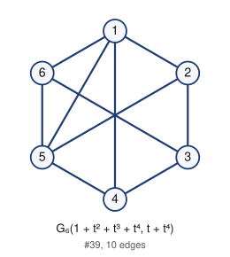

- edges (10): 12 14 15 16 23 25 34 36 45 56
- degree sequence: 4 4 3 3 3 3
- graph6: `Elug`
- complement is a labeled Riordan graph (same labeling): yes

Riordan matrix B = [ [t^i] g f^j ] (rows i = 0..4)      adjacency matrix A (lower triangle, rows 2..6)

```
1                  2: 1
0 1                3: 0 1
1 0 1              4: 1 0 1
1 1 0 1            5: 1 1 0 1
1 0 1 0 1          6: 1 0 1 0 1
```

## 40. G_6(1, t + t^3 + t^4)

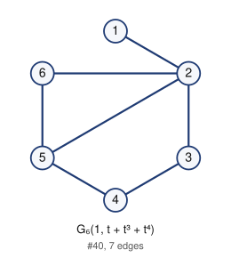

- edges (7): 12 23 25 26 34 45 56
- degree sequence: 4 3 2 2 2 1
- graph6: `EhTG`
- complement is a labeled Riordan graph (same labeling): yes

Riordan matrix B = [ [t^i] g f^j ] (rows i = 0..4)      adjacency matrix A (lower triangle, rows 2..6)

```
1                  2: 1
0 1                3: 0 1
0 0 1              4: 0 0 1
0 1 0 1            5: 0 1 0 1
0 1 0 0 1          6: 0 1 0 0 1
```

## 41. G_6(1 + t^2, t + t^3 + t^4)

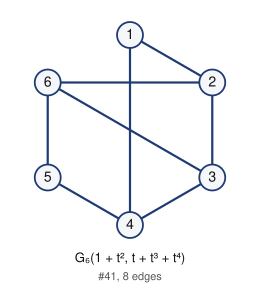

- edges (8): 12 14 23 26 34 36 45 56
- degree sequence: 3 3 3 3 2 2
- graph6: `ElDg`
- complement is a labeled Riordan graph (same labeling): yes

Riordan matrix B = [ [t^i] g f^j ] (rows i = 0..4)      adjacency matrix A (lower triangle, rows 2..6)

```
1                  2: 1
0 1                3: 0 1
1 0 1              4: 1 0 1
0 0 0 1            5: 0 0 0 1
0 1 1 0 1          6: 0 1 1 0 1
```

## 42. G_6(1 + t^3, t + t^3 + t^4)

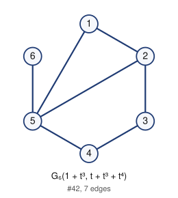

- edges (7): 12 15 23 25 34 45 56
- degree sequence: 4 3 2 2 2 1
- graph6: `EhsG`
- complement is a labeled Riordan graph (same labeling): yes

Riordan matrix B = [ [t^i] g f^j ] (rows i = 0..4)      adjacency matrix A (lower triangle, rows 2..6)

```
1                  2: 1
0 1                3: 0 1
0 0 1              4: 0 0 1
1 1 0 1            5: 1 1 0 1
0 0 0 0 1          6: 0 0 0 0 1
```

## 43. G_6(1 + t^2 + t^3, t + t^3 + t^4)

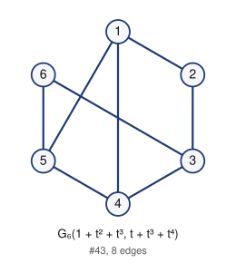

- edges (8): 12 14 15 23 34 36 45 56
- degree sequence: 3 3 3 3 2 2
- graph6: `Elcg`
- complement is a labeled Riordan graph (same labeling): yes

Riordan matrix B = [ [t^i] g f^j ] (rows i = 0..4)      adjacency matrix A (lower triangle, rows 2..6)

```
1                  2: 1
0 1                3: 0 1
1 0 1              4: 1 0 1
1 0 0 1            5: 1 0 0 1
0 0 1 0 1          6: 0 0 1 0 1
```

## 44. G_6(1 + t^4, t + t^3 + t^4)

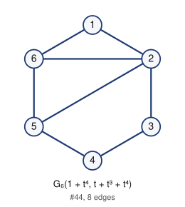

- edges (8): 12 16 23 25 26 34 45 56
- degree sequence: 4 3 3 2 2 2
- graph6: `EhVG`
- complement is a labeled Riordan graph (same labeling): yes

Riordan matrix B = [ [t^i] g f^j ] (rows i = 0..4)      adjacency matrix A (lower triangle, rows 2..6)

```
1                  2: 1
0 1                3: 0 1
0 0 1              4: 0 0 1
0 1 0 1            5: 0 1 0 1
1 1 0 0 1          6: 1 1 0 0 1
```

## 45. G_6(1 + t^2 + t^4, t + t^3 + t^4)

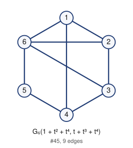

- edges (9): 12 14 16 23 26 34 36 45 56
- degree sequence: 4 3 3 3 3 2
- graph6: `ElFg`
- complement is a labeled Riordan graph (same labeling): yes

Riordan matrix B = [ [t^i] g f^j ] (rows i = 0..4)      adjacency matrix A (lower triangle, rows 2..6)

```
1                  2: 1
0 1                3: 0 1
1 0 1              4: 1 0 1
0 0 0 1            5: 0 0 0 1
1 1 1 0 1          6: 1 1 1 0 1
```

## 46. G_6(1 + t^3 + t^4, t + t^3 + t^4)

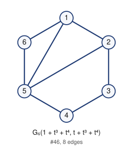

- edges (8): 12 15 16 23 25 34 45 56
- degree sequence: 4 3 3 2 2 2
- graph6: `EhuG`
- complement is a labeled Riordan graph (same labeling): yes

Riordan matrix B = [ [t^i] g f^j ] (rows i = 0..4)      adjacency matrix A (lower triangle, rows 2..6)

```
1                  2: 1
0 1                3: 0 1
0 0 1              4: 0 0 1
1 1 0 1            5: 1 1 0 1
1 0 0 0 1          6: 1 0 0 0 1
```

## 47. G_6(1 + t^2 + t^3 + t^4, t + t^3 + t^4)

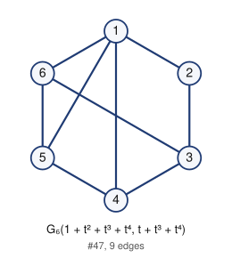

- edges (9): 12 14 15 16 23 34 36 45 56
- degree sequence: 4 3 3 3 3 2
- graph6: `Eleg`
- complement is a labeled Riordan graph (same labeling): yes

Riordan matrix B = [ [t^i] g f^j ] (rows i = 0..4)      adjacency matrix A (lower triangle, rows 2..6)

```
1                  2: 1
0 1                3: 0 1
1 0 1              4: 1 0 1
1 0 0 1            5: 1 0 0 1
1 0 1 0 1          6: 1 0 1 0 1
```

## 48. G_6(t, t)

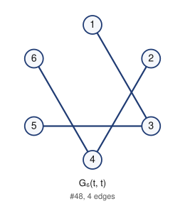

- edges (4): 13 24 35 46
- degree sequence: 2 2 1 1 1 1
- graph6: `EQGO`
- complement is a labeled Riordan graph (same labeling): yes

Riordan matrix B = [ [t^i] g f^j ] (rows i = 0..4)      adjacency matrix A (lower triangle, rows 2..6)

```
0                  2: 0
1 0                3: 1 0
0 1 0              4: 0 1 0
0 0 1 0            5: 0 0 1 0
0 0 0 1 0          6: 0 0 0 1 0
```

## 49. G_6(t + t^2, t)

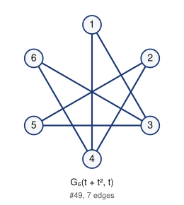

- edges (7): 13 14 24 25 35 36 46
- degree sequence: 3 3 2 2 2 2
- graph6: `EUWo`
- complement is a labeled Riordan graph (same labeling): yes

Riordan matrix B = [ [t^i] g f^j ] (rows i = 0..4)      adjacency matrix A (lower triangle, rows 2..6)

```
0                  2: 0
1 0                3: 1 0
1 1 0              4: 1 1 0
0 1 1 0            5: 0 1 1 0
0 0 1 1 0          6: 0 0 1 1 0
```

## 50. G_6(t + t^3, t)

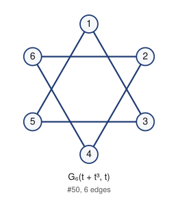

- edges (6): 13 15 24 26 35 46
- degree sequence: 2 2 2 2 2 2
- graph6: `EQhO`
- complement is a labeled Riordan graph (same labeling): yes

Riordan matrix B = [ [t^i] g f^j ] (rows i = 0..4)      adjacency matrix A (lower triangle, rows 2..6)

```
0                  2: 0
1 0                3: 1 0
0 1 0              4: 0 1 0
1 0 1 0            5: 1 0 1 0
0 1 0 1 0          6: 0 1 0 1 0
```

## 51. G_6(t + t^2 + t^3, t)

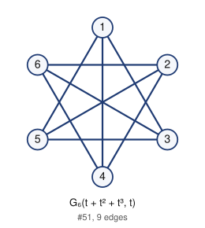

- edges (9): 13 14 15 24 25 26 35 36 46
- degree sequence: 3 3 3 3 3 3
- graph6: `EUxo`
- complement is a labeled Riordan graph (same labeling): yes

Riordan matrix B = [ [t^i] g f^j ] (rows i = 0..4)      adjacency matrix A (lower triangle, rows 2..6)

```
0                  2: 0
1 0                3: 1 0
1 1 0              4: 1 1 0
1 1 1 0            5: 1 1 1 0
0 1 1 1 0          6: 0 1 1 1 0
```

## 52. G_6(t + t^4, t)


- edges (5): 13 16 24 35 46
- degree sequence: 2 2 2 2 1 1
- graph6: `EQIO`
- complement is a labeled Riordan graph (same labeling): yes

Riordan matrix B = [ [t^i] g f^j ] (rows i = 0..4)      adjacency matrix A (lower triangle, rows 2..6)

```
0                  2: 0
1 0                3: 1 0
0 1 0              4: 0 1 0
0 0 1 0            5: 0 0 1 0
1 0 0 1 0          6: 1 0 0 1 0
```

## 53. G_6(t + t^2 + t^4, t)


- edges (8): 13 14 16 24 25 35 36 46
- degree sequence: 3 3 3 3 2 2
- graph6: `EUYo`
- complement is a labeled Riordan graph (same labeling): yes

Riordan matrix B = [ [t^i] g f^j ] (rows i = 0..4)      adjacency matrix A (lower triangle, rows 2..6)

```
0                  2: 0
1 0                3: 1 0
1 1 0              4: 1 1 0
0 1 1 0            5: 0 1 1 0
1 0 1 1 0          6: 1 0 1 1 0
```

## 54. G_6(t + t^3 + t^4, t)


- edges (7): 13 15 16 24 26 35 46
- degree sequence: 3 3 2 2 2 2
- graph6: `EQjO`
- complement is a labeled Riordan graph (same labeling): yes

Riordan matrix B = [ [t^i] g f^j ] (rows i = 0..4)      adjacency matrix A (lower triangle, rows 2..6)

```
0                  2: 0
1 0                3: 1 0
0 1 0              4: 0 1 0
1 0 1 0            5: 1 0 1 0
1 1 0 1 0          6: 1 1 0 1 0
```

## 55. G_6(t + t^2 + t^3 + t^4, t)


- edges (10): 13 14 15 16 24 25 26 35 36 46
- degree sequence: 4 4 3 3 3 3
- graph6: `EUzo`
- complement is a labeled Riordan graph (same labeling): yes

Riordan matrix B = [ [t^i] g f^j ] (rows i = 0..4)      adjacency matrix A (lower triangle, rows 2..6)

```
0                  2: 0
1 0                3: 1 0
1 1 0              4: 1 1 0
1 1 1 0            5: 1 1 1 0
1 1 1 1 0          6: 1 1 1 1 0
```

## 56. G_6(t, t + t^2)


- edges (5): 13 24 25 35 46
- degree sequence: 2 2 2 2 1 1
- graph6: `EQWO`
- complement is a labeled Riordan graph (same labeling): yes

Riordan matrix B = [ [t^i] g f^j ] (rows i = 0..4)      adjacency matrix A (lower triangle, rows 2..6)

```
0                  2: 0
1 0                3: 1 0
0 1 0              4: 0 1 0
0 1 1 0            5: 0 1 1 0
0 0 0 1 0          6: 0 0 0 1 0
```

## 57. G_6(t + t^2, t + t^2)


- edges (7): 13 14 24 26 35 36 46
- degree sequence: 3 3 3 2 2 1
- graph6: `EUHo`
- complement is a labeled Riordan graph (same labeling): yes

Riordan matrix B = [ [t^i] g f^j ] (rows i = 0..4)      adjacency matrix A (lower triangle, rows 2..6)

```
0                  2: 0
1 0                3: 1 0
1 1 0              4: 1 1 0
0 0 1 0            5: 0 0 1 0
0 1 1 1 0          6: 0 1 1 1 0
```

## 58. G_6(t + t^3, t + t^2)


- edges (7): 13 15 24 25 26 35 46
- degree sequence: 3 3 2 2 2 2
- graph6: `EQxO`
- complement is a labeled Riordan graph (same labeling): yes

Riordan matrix B = [ [t^i] g f^j ] (rows i = 0..4)      adjacency matrix A (lower triangle, rows 2..6)

```
0                  2: 0
1 0                3: 1 0
0 1 0              4: 0 1 0
1 1 1 0            5: 1 1 1 0
0 1 0 1 0          6: 0 1 0 1 0
```

## 59. G_6(t + t^2 + t^3, t + t^2)


- edges (7): 13 14 15 24 35 36 46
- degree sequence: 3 3 3 2 2 1
- graph6: `EUgo`
- complement is a labeled Riordan graph (same labeling): yes

Riordan matrix B = [ [t^i] g f^j ] (rows i = 0..4)      adjacency matrix A (lower triangle, rows 2..6)

```
0                  2: 0
1 0                3: 1 0
1 1 0              4: 1 1 0
1 0 1 0            5: 1 0 1 0
0 0 1 1 0          6: 0 0 1 1 0
```

## 60. G_6(t + t^4, t + t^2)


- edges (6): 13 16 24 25 35 46
- degree sequence: 2 2 2 2 2 2
- graph6: `EQYO`
- complement is a labeled Riordan graph (same labeling): yes

Riordan matrix B = [ [t^i] g f^j ] (rows i = 0..4)      adjacency matrix A (lower triangle, rows 2..6)

```
0                  2: 0
1 0                3: 1 0
0 1 0              4: 0 1 0
0 1 1 0            5: 0 1 1 0
1 0 0 1 0          6: 1 0 0 1 0
```

## 61. G_6(t + t^2 + t^4, t + t^2)


- edges (8): 13 14 16 24 26 35 36 46
- degree sequence: 4 3 3 3 2 1
- graph6: `EUJo`
- complement is a labeled Riordan graph (same labeling): yes

Riordan matrix B = [ [t^i] g f^j ] (rows i = 0..4)      adjacency matrix A (lower triangle, rows 2..6)

```
0                  2: 0
1 0                3: 1 0
1 1 0              4: 1 1 0
0 0 1 0            5: 0 0 1 0
1 1 1 1 0          6: 1 1 1 1 0
```

## 62. G_6(t + t^3 + t^4, t + t^2)


- edges (8): 13 15 16 24 25 26 35 46
- degree sequence: 3 3 3 3 2 2
- graph6: `EQzO`
- complement is a labeled Riordan graph (same labeling): yes

Riordan matrix B = [ [t^i] g f^j ] (rows i = 0..4)      adjacency matrix A (lower triangle, rows 2..6)

```
0                  2: 0
1 0                3: 1 0
0 1 0              4: 0 1 0
1 1 1 0            5: 1 1 1 0
1 1 0 1 0          6: 1 1 0 1 0
```

## 63. G_6(t + t^2 + t^3 + t^4, t + t^2)


- edges (8): 13 14 15 16 24 35 36 46
- degree sequence: 4 3 3 3 2 1
- graph6: `EUio`
- complement is a labeled Riordan graph (same labeling): yes

Riordan matrix B = [ [t^i] g f^j ] (rows i = 0..4)      adjacency matrix A (lower triangle, rows 2..6)

```
0                  2: 0
1 0                3: 1 0
1 1 0              4: 1 1 0
1 0 1 0            5: 1 0 1 0
1 0 1 1 0          6: 1 0 1 1 0
```

## 64. G_6(t, t + t^3)


- edges (5): 13 24 26 35 46
- degree sequence: 2 2 2 2 1 1
- graph6: `EQHO`
- complement is a labeled Riordan graph (same labeling): yes

Riordan matrix B = [ [t^i] g f^j ] (rows i = 0..4)      adjacency matrix A (lower triangle, rows 2..6)

```
0                  2: 0
1 0                3: 1 0
0 1 0              4: 0 1 0
0 0 1 0            5: 0 0 1 0
0 1 0 1 0          6: 0 1 0 1 0
```

## 65. G_6(t + t^2, t + t^3)


- edges (8): 13 14 24 25 26 35 36 46
- degree sequence: 3 3 3 3 2 2
- graph6: `EUXo`
- complement is a labeled Riordan graph (same labeling): yes

Riordan matrix B = [ [t^i] g f^j ] (rows i = 0..4)      adjacency matrix A (lower triangle, rows 2..6)

```
0                  2: 0
1 0                3: 1 0
1 1 0              4: 1 1 0
0 1 1 0            5: 0 1 1 0
0 1 1 1 0          6: 0 1 1 1 0
```

## 66. G_6(t + t^3, t + t^3)


- edges (5): 13 15 24 35 46
- degree sequence: 2 2 2 2 1 1
- graph6: `EQgO`
- complement is a labeled Riordan graph (same labeling): yes

Riordan matrix B = [ [t^i] g f^j ] (rows i = 0..4)      adjacency matrix A (lower triangle, rows 2..6)

```
0                  2: 0
1 0                3: 1 0
0 1 0              4: 0 1 0
1 0 1 0            5: 1 0 1 0
0 0 0 1 0          6: 0 0 0 1 0
```

## 67. G_6(t + t^2 + t^3, t + t^3)


- edges (8): 13 14 15 24 25 35 36 46
- degree sequence: 3 3 3 3 2 2
- graph6: `EUwo`
- complement is a labeled Riordan graph (same labeling): yes

Riordan matrix B = [ [t^i] g f^j ] (rows i = 0..4)      adjacency matrix A (lower triangle, rows 2..6)

```
0                  2: 0
1 0                3: 1 0
1 1 0              4: 1 1 0
1 1 1 0            5: 1 1 1 0
0 0 1 1 0          6: 0 0 1 1 0
```

## 68. G_6(t + t^4, t + t^3)


- edges (6): 13 16 24 26 35 46
- degree sequence: 3 2 2 2 2 1
- graph6: `EQJO`
- complement is a labeled Riordan graph (same labeling): yes

Riordan matrix B = [ [t^i] g f^j ] (rows i = 0..4)      adjacency matrix A (lower triangle, rows 2..6)

```
0                  2: 0
1 0                3: 1 0
0 1 0              4: 0 1 0
0 0 1 0            5: 0 0 1 0
1 1 0 1 0          6: 1 1 0 1 0
```

## 69. G_6(t + t^2 + t^4, t + t^3)


- edges (9): 13 14 16 24 25 26 35 36 46
- degree sequence: 4 3 3 3 3 2
- graph6: `EUZo`
- complement is a labeled Riordan graph (same labeling): yes

Riordan matrix B = [ [t^i] g f^j ] (rows i = 0..4)      adjacency matrix A (lower triangle, rows 2..6)

```
0                  2: 0
1 0                3: 1 0
1 1 0              4: 1 1 0
0 1 1 0            5: 0 1 1 0
1 1 1 1 0          6: 1 1 1 1 0
```

## 70. G_6(t + t^3 + t^4, t + t^3)


- edges (6): 13 15 16 24 35 46
- degree sequence: 3 2 2 2 2 1
- graph6: `EQiO`
- complement is a labeled Riordan graph (same labeling): yes

Riordan matrix B = [ [t^i] g f^j ] (rows i = 0..4)      adjacency matrix A (lower triangle, rows 2..6)

```
0                  2: 0
1 0                3: 1 0
0 1 0              4: 0 1 0
1 0 1 0            5: 1 0 1 0
1 0 0 1 0          6: 1 0 0 1 0
```

## 71. G_6(t + t^2 + t^3 + t^4, t + t^3)


- edges (9): 13 14 15 16 24 25 35 36 46
- degree sequence: 4 3 3 3 3 2
- graph6: `EUyo`
- complement is a labeled Riordan graph (same labeling): yes

Riordan matrix B = [ [t^i] g f^j ] (rows i = 0..4)      adjacency matrix A (lower triangle, rows 2..6)

```
0                  2: 0
1 0                3: 1 0
1 1 0              4: 1 1 0
1 1 1 0            5: 1 1 1 0
1 0 1 1 0          6: 1 0 1 1 0
```

## 72. G_6(t, t + t^2 + t^3)


- edges (6): 13 24 25 26 35 46
- degree sequence: 3 2 2 2 2 1
- graph6: `EQXO`
- complement is a labeled Riordan graph (same labeling): yes

Riordan matrix B = [ [t^i] g f^j ] (rows i = 0..4)      adjacency matrix A (lower triangle, rows 2..6)

```
0                  2: 0
1 0                3: 1 0
0 1 0              4: 0 1 0
0 1 1 0            5: 0 1 1 0
0 1 0 1 0          6: 0 1 0 1 0
```

## 73. G_6(t + t^2, t + t^2 + t^3)


- edges (6): 13 14 24 35 36 46
- degree sequence: 3 3 2 2 1 1
- graph6: `EUGo`
- complement is a labeled Riordan graph (same labeling): yes

Riordan matrix B = [ [t^i] g f^j ] (rows i = 0..4)      adjacency matrix A (lower triangle, rows 2..6)

```
0                  2: 0
1 0                3: 1 0
1 1 0              4: 1 1 0
0 0 1 0            5: 0 0 1 0
0 0 1 1 0          6: 0 0 1 1 0
```

## 74. G_6(t + t^3, t + t^2 + t^3)


- edges (6): 13 15 24 25 35 46
- degree sequence: 3 2 2 2 2 1
- graph6: `EQwO`
- complement is a labeled Riordan graph (same labeling): yes

Riordan matrix B = [ [t^i] g f^j ] (rows i = 0..4)      adjacency matrix A (lower triangle, rows 2..6)

```
0                  2: 0
1 0                3: 1 0
0 1 0              4: 0 1 0
1 1 1 0            5: 1 1 1 0
0 0 0 1 0          6: 0 0 0 1 0
```

## 75. G_6(t + t^2 + t^3, t + t^2 + t^3)


- edges (8): 13 14 15 24 26 35 36 46
- degree sequence: 3 3 3 3 2 2
- graph6: `EUho`
- complement is a labeled Riordan graph (same labeling): yes

Riordan matrix B = [ [t^i] g f^j ] (rows i = 0..4)      adjacency matrix A (lower triangle, rows 2..6)

```
0                  2: 0
1 0                3: 1 0
1 1 0              4: 1 1 0
1 0 1 0            5: 1 0 1 0
0 1 1 1 0          6: 0 1 1 1 0
```

## 76. G_6(t + t^4, t + t^2 + t^3)


- edges (7): 13 16 24 25 26 35 46
- degree sequence: 3 3 2 2 2 2
- graph6: `EQZO`
- complement is a labeled Riordan graph (same labeling): yes

Riordan matrix B = [ [t^i] g f^j ] (rows i = 0..4)      adjacency matrix A (lower triangle, rows 2..6)

```
0                  2: 0
1 0                3: 1 0
0 1 0              4: 0 1 0
0 1 1 0            5: 0 1 1 0
1 1 0 1 0          6: 1 1 0 1 0
```

## 77. G_6(t + t^2 + t^4, t + t^2 + t^3)


- edges (7): 13 14 16 24 35 36 46
- degree sequence: 3 3 3 3 1 1
- graph6: `EUIo`
- complement is a labeled Riordan graph (same labeling): yes

Riordan matrix B = [ [t^i] g f^j ] (rows i = 0..4)      adjacency matrix A (lower triangle, rows 2..6)

```
0                  2: 0
1 0                3: 1 0
1 1 0              4: 1 1 0
0 0 1 0            5: 0 0 1 0
1 0 1 1 0          6: 1 0 1 1 0
```

## 78. G_6(t + t^3 + t^4, t + t^2 + t^3)


- edges (7): 13 15 16 24 25 35 46
- degree sequence: 3 3 2 2 2 2
- graph6: `EQyO`
- complement is a labeled Riordan graph (same labeling): yes

Riordan matrix B = [ [t^i] g f^j ] (rows i = 0..4)      adjacency matrix A (lower triangle, rows 2..6)

```
0                  2: 0
1 0                3: 1 0
0 1 0              4: 0 1 0
1 1 1 0            5: 1 1 1 0
1 0 0 1 0          6: 1 0 0 1 0
```

## 79. G_6(t + t^2 + t^3 + t^4, t + t^2 + t^3)


- edges (9): 13 14 15 16 24 26 35 36 46
- degree sequence: 4 4 3 3 2 2
- graph6: `EUjo`
- complement is a labeled Riordan graph (same labeling): yes

Riordan matrix B = [ [t^i] g f^j ] (rows i = 0..4)      adjacency matrix A (lower triangle, rows 2..6)

```
0                  2: 0
1 0                3: 1 0
1 1 0              4: 1 1 0
1 0 1 0            5: 1 0 1 0
1 1 1 1 0          6: 1 1 1 1 0
```

## 80. G_6(t^2, t)


- edges (3): 14 25 36
- degree sequence: 1 1 1 1 1 1
- graph6: `ECO_`
- complement is a labeled Riordan graph (same labeling): yes

Riordan matrix B = [ [t^i] g f^j ] (rows i = 0..4)      adjacency matrix A (lower triangle, rows 2..6)

```
0                  2: 0
0 0                3: 0 0
1 0 0              4: 1 0 0
0 1 0 0            5: 0 1 0 0
0 0 1 0 0          6: 0 0 1 0 0
```

## 81. G_6(t^2 + t^3, t)


- edges (5): 14 15 25 26 36
- degree sequence: 2 2 2 2 1 1
- graph6: `ECp_`
- complement is a labeled Riordan graph (same labeling): yes

Riordan matrix B = [ [t^i] g f^j ] (rows i = 0..4)      adjacency matrix A (lower triangle, rows 2..6)

```
0                  2: 0
0 0                3: 0 0
1 0 0              4: 1 0 0
1 1 0 0            5: 1 1 0 0
0 1 1 0 0          6: 0 1 1 0 0
```

## 82. G_6(t^2 + t^4, t)


- edges (4): 14 16 25 36
- degree sequence: 2 2 1 1 1 1
- graph6: `ECQ_`
- complement is a labeled Riordan graph (same labeling): yes

Riordan matrix B = [ [t^i] g f^j ] (rows i = 0..4)      adjacency matrix A (lower triangle, rows 2..6)

```
0                  2: 0
0 0                3: 0 0
1 0 0              4: 1 0 0
0 1 0 0            5: 0 1 0 0
1 0 1 0 0          6: 1 0 1 0 0
```

## 83. G_6(t^2 + t^3 + t^4, t)


- edges (6): 14 15 16 25 26 36
- degree sequence: 3 3 2 2 1 1
- graph6: `ECr_`
- complement is a labeled Riordan graph (same labeling): yes

Riordan matrix B = [ [t^i] g f^j ] (rows i = 0..4)      adjacency matrix A (lower triangle, rows 2..6)

```
0                  2: 0
0 0                3: 0 0
1 0 0              4: 1 0 0
1 1 0 0            5: 1 1 0 0
1 1 1 0 0          6: 1 1 1 0 0
```

## 84. G_6(t^2, t + t^2)


- edges (4): 14 25 26 36
- degree sequence: 2 2 1 1 1 1
- graph6: `ECP_`
- complement is a labeled Riordan graph (same labeling): yes

Riordan matrix B = [ [t^i] g f^j ] (rows i = 0..4)      adjacency matrix A (lower triangle, rows 2..6)

```
0                  2: 0
0 0                3: 0 0
1 0 0              4: 1 0 0
0 1 0 0            5: 0 1 0 0
0 1 1 0 0          6: 0 1 1 0 0
```

## 85. G_6(t^2 + t^3, t + t^2)


- edges (4): 14 15 25 36
- degree sequence: 2 2 1 1 1 1
- graph6: `ECo_`
- complement is a labeled Riordan graph (same labeling): yes

Riordan matrix B = [ [t^i] g f^j ] (rows i = 0..4)      adjacency matrix A (lower triangle, rows 2..6)

```
0                  2: 0
0 0                3: 0 0
1 0 0              4: 1 0 0
1 1 0 0            5: 1 1 0 0
0 0 1 0 0          6: 0 0 1 0 0
```

## 86. G_6(t^2 + t^4, t + t^2)


- edges (5): 14 16 25 26 36
- degree sequence: 3 2 2 1 1 1
- graph6: `ECR_`
- complement is a labeled Riordan graph (same labeling): yes

Riordan matrix B = [ [t^i] g f^j ] (rows i = 0..4)      adjacency matrix A (lower triangle, rows 2..6)

```
0                  2: 0
0 0                3: 0 0
1 0 0              4: 1 0 0
0 1 0 0            5: 0 1 0 0
1 1 1 0 0          6: 1 1 1 0 0
```

## 87. G_6(t^2 + t^3 + t^4, t + t^2)


- edges (5): 14 15 16 25 36
- degree sequence: 3 2 2 1 1 1
- graph6: `ECq_`
- complement is a labeled Riordan graph (same labeling): yes

Riordan matrix B = [ [t^i] g f^j ] (rows i = 0..4)      adjacency matrix A (lower triangle, rows 2..6)

```
0                  2: 0
0 0                3: 0 0
1 0 0              4: 1 0 0
1 1 0 0            5: 1 1 0 0
1 0 1 0 0          6: 1 0 1 0 0
```

## 88. G_6(t^3, 0)


- edges (1): 15
- degree sequence: 1 1 0 0 0 0
- graph6: `E?_?`
- complement is a labeled Riordan graph (same labeling): yes

Riordan matrix B = [ [t^i] g f^j ] (rows i = 0..4)      adjacency matrix A (lower triangle, rows 2..6)

```
0                  2: 0
0 0                3: 0 0
0 0 0              4: 0 0 0
1 0 0 0            5: 1 0 0 0
0 0 0 0 0          6: 0 0 0 0 0
```

## 89. G_6(t^3 + t^4, 0)


- edges (2): 15 16
- degree sequence: 2 1 1 0 0 0
- graph6: `E?a?`
- complement is a labeled Riordan graph (same labeling): yes

Riordan matrix B = [ [t^i] g f^j ] (rows i = 0..4)      adjacency matrix A (lower triangle, rows 2..6)

```
0                  2: 0
0 0                3: 0 0
0 0 0              4: 0 0 0
1 0 0 0            5: 1 0 0 0
1 0 0 0 0          6: 1 0 0 0 0
```

## 90. G_6(t^3, t)


- edges (2): 15 26
- degree sequence: 1 1 1 1 0 0
- graph6: `E?`?`
- complement is a labeled Riordan graph (same labeling): yes

Riordan matrix B = [ [t^i] g f^j ] (rows i = 0..4)      adjacency matrix A (lower triangle, rows 2..6)

```
0                  2: 0
0 0                3: 0 0
0 0 0              4: 0 0 0
1 0 0 0            5: 1 0 0 0
0 1 0 0 0          6: 0 1 0 0 0
```

## 91. G_6(t^3 + t^4, t)


- edges (3): 15 16 26
- degree sequence: 2 2 1 1 0 0
- graph6: `E?b?`
- complement is a labeled Riordan graph (same labeling): yes

Riordan matrix B = [ [t^i] g f^j ] (rows i = 0..4)      adjacency matrix A (lower triangle, rows 2..6)

```
0                  2: 0
0 0                3: 0 0
0 0 0              4: 0 0 0
1 0 0 0            5: 1 0 0 0
1 1 0 0 0          6: 1 1 0 0 0
```

## 92. G_6(t^4, 0)


- edges (1): 16
- degree sequence: 1 1 0 0 0 0
- graph6: `E?A?`
- complement is a labeled Riordan graph (same labeling): yes

Riordan matrix B = [ [t^i] g f^j ] (rows i = 0..4)      adjacency matrix A (lower triangle, rows 2..6)

```
0                  2: 0
0 0                3: 0 0
0 0 0              4: 0 0 0
0 0 0 0            5: 0 0 0 0
1 0 0 0 0          6: 1 0 0 0 0
```

