# Unlabeled Riordan graphs of order 6 (filter: complement): 90

## 1. G_6(0, 0)


- edges (0): 
- degree sequence: 0 0 0 0 0 0
- graph6: `E???`
- labeled Riordan graphs in this class: 1
- complement is Riordan: yes

Riordan matrix B = [ [t^i] g f^j ] (rows i = 0..4)      adjacency matrix A (lower triangle, rows 2..6)

```
0                  2: 0
0 0                3: 0 0
0 0 0              4: 0 0 0
0 0 0 0            5: 0 0 0 0
0 0 0 0 0          6: 0 0 0 0 0
```

## 2. G_6(1, 0)

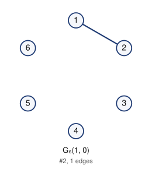

- edges (1): 12
- degree sequence: 1 1 0 0 0 0
- graph6: `E_??`
- labeled Riordan graphs in this class: 5
- complement is Riordan: yes

Riordan matrix B = [ [t^i] g f^j ] (rows i = 0..4)      adjacency matrix A (lower triangle, rows 2..6)

```
1                  2: 1
0 0                3: 0 0
0 0 0              4: 0 0 0
0 0 0 0            5: 0 0 0 0
0 0 0 0 0          6: 0 0 0 0 0
```

## 3. G_6(1, t^3)

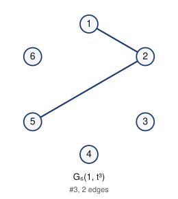

- edges (2): 12 25
- degree sequence: 2 1 1 0 0 0
- graph6: `E_O?`
- labeled Riordan graphs in this class: 12
- complement is Riordan: yes

Riordan matrix B = [ [t^i] g f^j ] (rows i = 0..4)      adjacency matrix A (lower triangle, rows 2..6)

```
1                  2: 1
0 0                3: 0 0
0 0 0              4: 0 0 0
0 1 0 0            5: 0 1 0 0
0 0 0 0 0          6: 0 0 0 0 0
```

## 4. G_6(t, t^2)

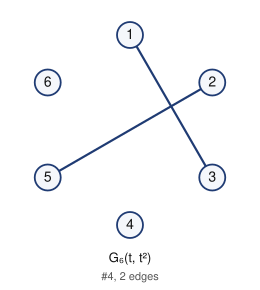

- edges (2): 13 25
- degree sequence: 1 1 1 1 0 0
- graph6: `EOO?`
- labeled Riordan graphs in this class: 4
- complement is Riordan: yes

Riordan matrix B = [ [t^i] g f^j ] (rows i = 0..4)      adjacency matrix A (lower triangle, rows 2..6)

```
0                  2: 0
1 0                3: 1 0
0 0 0              4: 0 0 0
0 1 0 0            5: 0 1 0 0
0 0 0 0 0          6: 0 0 0 0 0
```

## 5. G_6(1, t^2)

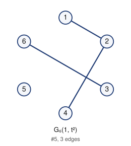

- edges (3): 12 24 36
- degree sequence: 2 1 1 1 1 0
- graph6: `Ea?_`
- labeled Riordan graphs in this class: 7
- complement is Riordan: yes

Riordan matrix B = [ [t^i] g f^j ] (rows i = 0..4)      adjacency matrix A (lower triangle, rows 2..6)

```
1                  2: 1
0 0                3: 0 0
0 1 0              4: 0 1 0
0 0 0 0            5: 0 0 0 0
0 0 1 0 0          6: 0 0 1 0 0
```

## 6. G_6(t^2, t)

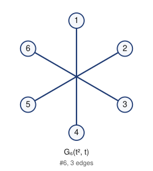

- edges (3): 14 25 36
- degree sequence: 1 1 1 1 1 1
- graph6: `ECO_`
- labeled Riordan graphs in this class: 1
- complement is Riordan: yes

Riordan matrix B = [ [t^i] g f^j ] (rows i = 0..4)      adjacency matrix A (lower triangle, rows 2..6)

```
0                  2: 0
0 0                3: 0 0
1 0 0              4: 1 0 0
0 1 0 0            5: 0 1 0 0
0 0 1 0 0          6: 0 0 1 0 0
```

## 7. G_6(1, t^3 + t^4)

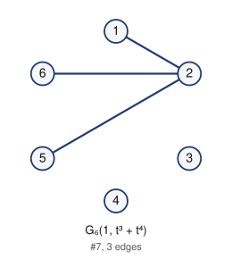

- edges (3): 12 25 26
- degree sequence: 3 1 1 1 0 0
- graph6: `E_P?`
- labeled Riordan graphs in this class: 11
- complement is Riordan: yes

Riordan matrix B = [ [t^i] g f^j ] (rows i = 0..4)      adjacency matrix A (lower triangle, rows 2..6)

```
1                  2: 1
0 0                3: 0 0
0 0 0              4: 0 0 0
0 1 0 0            5: 0 1 0 0
0 1 0 0 0          6: 0 1 0 0 0
```

## 8. G_6(1 + t, t^4)

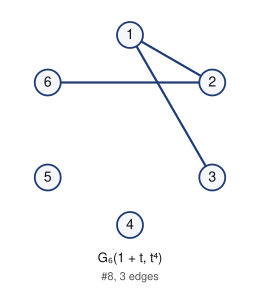

- edges (3): 12 13 26
- degree sequence: 2 2 1 1 0 0
- graph6: `Eo@?`
- labeled Riordan graphs in this class: 10
- complement is Riordan: yes

Riordan matrix B = [ [t^i] g f^j ] (rows i = 0..4)      adjacency matrix A (lower triangle, rows 2..6)

```
1                  2: 1
1 0                3: 1 0
0 0 0              4: 0 0 0
0 0 0 0            5: 0 0 0 0
0 1 0 0 0          6: 0 1 0 0 0
```

## 9. G_6(t, t)

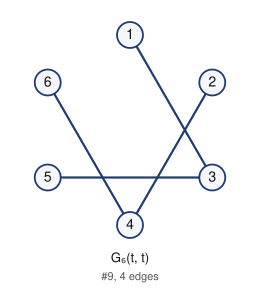

- edges (4): 13 24 35 46
- degree sequence: 2 2 1 1 1 1
- graph6: `EQGO`
- labeled Riordan graphs in this class: 2
- complement is Riordan: yes

Riordan matrix B = [ [t^i] g f^j ] (rows i = 0..4)      adjacency matrix A (lower triangle, rows 2..6)

```
0                  2: 0
1 0                3: 1 0
0 1 0              4: 0 1 0
0 0 1 0            5: 0 0 1 0
0 0 0 1 0          6: 0 0 0 1 0
```

## 10. G_6(1, t^2 + t^4)

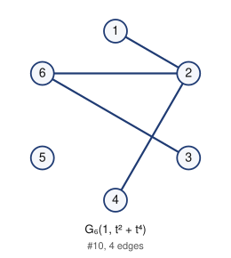

- edges (4): 12 24 26 36
- degree sequence: 3 2 1 1 1 0
- graph6: `Ea@_`
- labeled Riordan graphs in this class: 14
- complement is Riordan: yes

Riordan matrix B = [ [t^i] g f^j ] (rows i = 0..4)      adjacency matrix A (lower triangle, rows 2..6)

```
1                  2: 1
0 0                3: 0 0
0 1 0              4: 0 1 0
0 0 0 0            5: 0 0 0 0
0 1 1 0 0          6: 0 1 1 0 0
```

## 11. G_6(t^2, t + t^2)

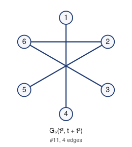

- edges (4): 14 25 26 36
- degree sequence: 2 2 1 1 1 1
- graph6: `ECP_`
- labeled Riordan graphs in this class: 4
- complement is Riordan: yes

Riordan matrix B = [ [t^i] g f^j ] (rows i = 0..4)      adjacency matrix A (lower triangle, rows 2..6)

```
0                  2: 0
0 0                3: 0 0
1 0 0              4: 1 0 0
0 1 0 0            5: 0 1 0 0
0 1 1 0 0          6: 0 1 1 0 0
```

## 12. G_6(1 + t^4, t^2)

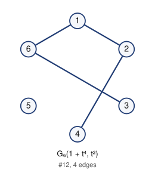

- edges (4): 12 16 24 36
- degree sequence: 2 2 2 1 1 0
- graph6: `EaA_`
- labeled Riordan graphs in this class: 4
- complement is Riordan: yes

Riordan matrix B = [ [t^i] g f^j ] (rows i = 0..4)      adjacency matrix A (lower triangle, rows 2..6)

```
1                  2: 1
0 0                3: 0 0
0 1 0              4: 0 1 0
0 0 0 0            5: 0 0 0 0
1 0 1 0 0          6: 1 0 1 0 0
```

## 13. G_6(1 + t^3, t^3 + t^4)

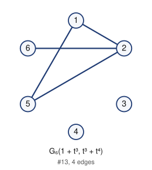

- edges (4): 12 15 25 26
- degree sequence: 3 2 2 1 0 0
- graph6: `E_p?`
- labeled Riordan graphs in this class: 8
- complement is Riordan: yes

Riordan matrix B = [ [t^i] g f^j ] (rows i = 0..4)      adjacency matrix A (lower triangle, rows 2..6)

```
1                  2: 1
0 0                3: 0 0
0 0 0              4: 0 0 0
1 1 0 0            5: 1 1 0 0
0 1 0 0 0          6: 0 1 0 0 0
```

## 14. G_6(1, t)

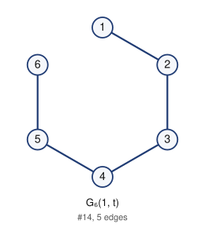

- edges (5): 12 23 34 45 56
- degree sequence: 2 2 2 2 1 1
- graph6: `EhCG`
- labeled Riordan graphs in this class: 4
- complement is Riordan: yes

Riordan matrix B = [ [t^i] g f^j ] (rows i = 0..4)      adjacency matrix A (lower triangle, rows 2..6)

```
1                  2: 1
0 1                3: 0 1
0 0 1              4: 0 0 1
0 0 0 1            5: 0 0 0 1
0 0 0 0 1          6: 0 0 0 0 1
```

## 15. G_6(t, t + t^3)

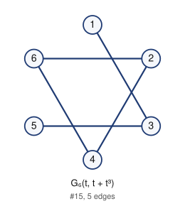

- edges (5): 13 24 26 35 46
- degree sequence: 2 2 2 2 1 1
- graph6: `EQHO`
- labeled Riordan graphs in this class: 2
- complement is Riordan: yes

Riordan matrix B = [ [t^i] g f^j ] (rows i = 0..4)      adjacency matrix A (lower triangle, rows 2..6)

```
0                  2: 0
1 0                3: 1 0
0 1 0              4: 0 1 0
0 0 1 0            5: 0 0 1 0
0 1 0 1 0          6: 0 1 0 1 0
```

## 16. G_6(1 + t, t^2)

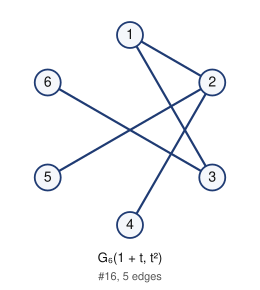

- edges (5): 12 13 24 25 36
- degree sequence: 3 2 2 1 1 1
- graph6: `EqO_`
- labeled Riordan graphs in this class: 4
- complement is Riordan: yes

Riordan matrix B = [ [t^i] g f^j ] (rows i = 0..4)      adjacency matrix A (lower triangle, rows 2..6)

```
1                  2: 1
1 0                3: 1 0
0 1 0              4: 0 1 0
0 1 0 0            5: 0 1 0 0
0 0 1 0 0          6: 0 0 1 0 0
```

## 17. G_6(1 + t^2, t^2)

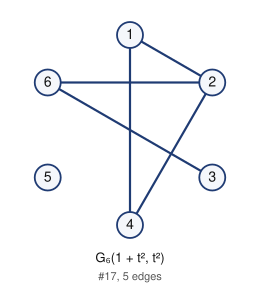

- edges (5): 12 14 24 26 36
- degree sequence: 3 2 2 2 1 0
- graph6: `Ee@_`
- labeled Riordan graphs in this class: 4
- complement is Riordan: yes

Riordan matrix B = [ [t^i] g f^j ] (rows i = 0..4)      adjacency matrix A (lower triangle, rows 2..6)

```
1                  2: 1
0 0                3: 0 0
1 1 0              4: 1 1 0
0 0 0 0            5: 0 0 0 0
0 1 1 0 0          6: 0 1 1 0 0
```

## 18. G_6(1 + t, t^2 + t^3)

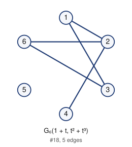

- edges (5): 12 13 24 26 36
- degree sequence: 3 2 2 2 1 0
- graph6: `Eq@_`
- labeled Riordan graphs in this class: 2
- complement is Riordan: yes

Riordan matrix B = [ [t^i] g f^j ] (rows i = 0..4)      adjacency matrix A (lower triangle, rows 2..6)

```
1                  2: 1
1 0                3: 1 0
0 1 0              4: 0 1 0
0 0 0 0            5: 0 0 0 0
0 1 1 0 0          6: 0 1 1 0 0
```

## 19. G_6(1 + t + t^2, t^3)

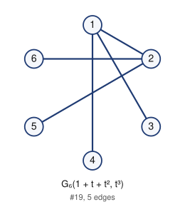

- edges (5): 12 13 14 25 26
- degree sequence: 3 3 1 1 1 1
- graph6: `EsP?`
- labeled Riordan graphs in this class: 1
- complement is Riordan: yes

Riordan matrix B = [ [t^i] g f^j ] (rows i = 0..4)      adjacency matrix A (lower triangle, rows 2..6)

```
1                  2: 1
1 0                3: 1 0
1 0 0              4: 1 0 0
0 1 0 0            5: 0 1 0 0
0 1 0 0 0          6: 0 1 0 0 0
```

## 20. G_6(1 + t^3, t^2 + t^3)

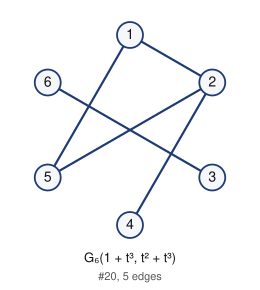

- edges (5): 12 15 24 25 36
- degree sequence: 3 2 2 1 1 1
- graph6: `Eao_`
- labeled Riordan graphs in this class: 3
- complement is Riordan: yes

Riordan matrix B = [ [t^i] g f^j ] (rows i = 0..4)      adjacency matrix A (lower triangle, rows 2..6)

```
1                  2: 1
0 0                3: 0 0
0 1 0              4: 0 1 0
1 1 0 0            5: 1 1 0 0
0 0 1 0 0          6: 0 0 1 0 0
```

## 21. G_6(1 + t^3, t^2 + t^4)

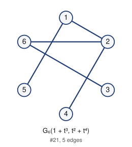

- edges (5): 12 15 24 26 36
- degree sequence: 3 2 2 1 1 1
- graph6: `Ea`_`
- labeled Riordan graphs in this class: 5
- complement is Riordan: yes

Riordan matrix B = [ [t^i] g f^j ] (rows i = 0..4)      adjacency matrix A (lower triangle, rows 2..6)

```
1                  2: 1
0 0                3: 0 0
0 1 0              4: 0 1 0
1 0 0 0            5: 1 0 0 0
0 1 1 0 0          6: 0 1 1 0 0
```

## 22. G_6(1 + t + t^3, t^3)

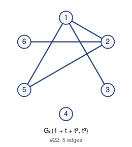

- edges (5): 12 13 15 25 26
- degree sequence: 3 3 2 1 1 0
- graph6: `Eop?`
- labeled Riordan graphs in this class: 5
- complement is Riordan: yes

Riordan matrix B = [ [t^i] g f^j ] (rows i = 0..4)      adjacency matrix A (lower triangle, rows 2..6)

```
1                  2: 1
1 0                3: 1 0
0 0 0              4: 0 0 0
1 1 0 0            5: 1 1 0 0
0 1 0 0 0          6: 0 1 0 0 0
```

## 23. G_6(1 + t + t^2 + t^4, t^4)

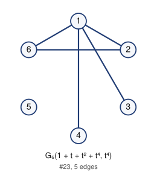

- edges (5): 12 13 14 16 26
- degree sequence: 4 2 2 1 1 0
- graph6: `EsB?`
- labeled Riordan graphs in this class: 6
- complement is Riordan: yes

Riordan matrix B = [ [t^i] g f^j ] (rows i = 0..4)      adjacency matrix A (lower triangle, rows 2..6)

```
1                  2: 1
1 0                3: 1 0
1 0 0              4: 1 0 0
0 0 0 0            5: 0 0 0 0
1 1 0 0 0          6: 1 1 0 0 0
```

## 24. G_6(1 + t^3 + t^4, t^3 + t^4)

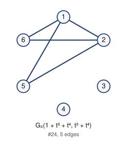

- edges (5): 12 15 16 25 26
- degree sequence: 3 3 2 2 0 0
- graph6: `E_r?`
- labeled Riordan graphs in this class: 1
- complement is Riordan: yes

Riordan matrix B = [ [t^i] g f^j ] (rows i = 0..4)      adjacency matrix A (lower triangle, rows 2..6)

```
1                  2: 1
0 0                3: 0 0
0 0 0              4: 0 0 0
1 1 0 0            5: 1 1 0 0
1 1 0 0 0          6: 1 1 0 0 0
```

## 25. G_6(1, t + t^3)

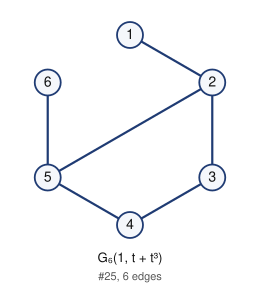

- edges (6): 12 23 25 34 45 56
- degree sequence: 3 3 2 2 1 1
- graph6: `EhSG`
- labeled Riordan graphs in this class: 3
- complement is Riordan: yes

Riordan matrix B = [ [t^i] g f^j ] (rows i = 0..4)      adjacency matrix A (lower triangle, rows 2..6)

```
1                  2: 1
0 1                3: 0 1
0 0 1              4: 0 0 1
0 1 0 1            5: 0 1 0 1
0 0 0 0 1          6: 0 0 0 0 1
```

## 26. G_6(1, t + t^4)

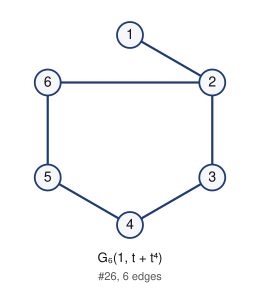

- edges (6): 12 23 26 34 45 56
- degree sequence: 3 2 2 2 2 1
- graph6: `EhDG`
- labeled Riordan graphs in this class: 2
- complement is Riordan: yes

Riordan matrix B = [ [t^i] g f^j ] (rows i = 0..4)      adjacency matrix A (lower triangle, rows 2..6)

```
1                  2: 1
0 1                3: 0 1
0 0 1              4: 0 0 1
0 0 0 1            5: 0 0 0 1
0 1 0 0 1          6: 0 1 0 0 1
```

## 27. G_6(t + t^3, t)

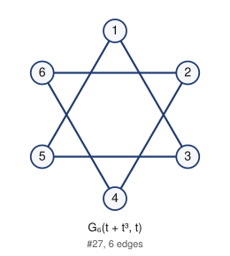

- edges (6): 13 15 24 26 35 46
- degree sequence: 2 2 2 2 2 2
- graph6: `EQhO`
- labeled Riordan graphs in this class: 1
- complement is Riordan: yes

Riordan matrix B = [ [t^i] g f^j ] (rows i = 0..4)      adjacency matrix A (lower triangle, rows 2..6)

```
0                  2: 0
1 0                3: 1 0
0 1 0              4: 0 1 0
1 0 1 0            5: 1 0 1 0
0 1 0 1 0          6: 0 1 0 1 0
```

## 28. G_6(1 + t^4, t)

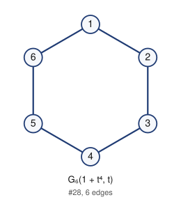

- edges (6): 12 16 23 34 45 56
- degree sequence: 2 2 2 2 2 2
- graph6: `EhEG`
- labeled Riordan graphs in this class: 2
- complement is Riordan: yes

Riordan matrix B = [ [t^i] g f^j ] (rows i = 0..4)      adjacency matrix A (lower triangle, rows 2..6)

```
1                  2: 1
0 1                3: 0 1
0 0 1              4: 0 0 1
0 0 0 1            5: 0 0 0 1
1 0 0 0 1          6: 1 0 0 0 1
```

## 29. G_6(t, t + t^2 + t^3)

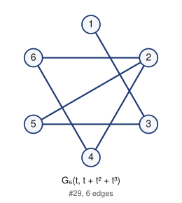

- edges (6): 13 24 25 26 35 46
- degree sequence: 3 2 2 2 2 1
- graph6: `EQXO`
- labeled Riordan graphs in this class: 4
- complement is Riordan: yes

Riordan matrix B = [ [t^i] g f^j ] (rows i = 0..4)      adjacency matrix A (lower triangle, rows 2..6)

```
0                  2: 0
1 0                3: 1 0
0 1 0              4: 0 1 0
0 1 1 0            5: 0 1 1 0
0 1 0 1 0          6: 0 1 0 1 0
```

## 30. G_6(1 + t^2, t^2 + t^3)

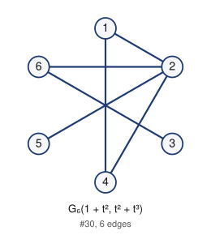

- edges (6): 12 14 24 25 26 36
- degree sequence: 4 2 2 2 1 1
- graph6: `EeP_`
- labeled Riordan graphs in this class: 5
- complement is Riordan: yes

Riordan matrix B = [ [t^i] g f^j ] (rows i = 0..4)      adjacency matrix A (lower triangle, rows 2..6)

```
1                  2: 1
0 0                3: 0 0
1 1 0              4: 1 1 0
0 1 0 0            5: 0 1 0 0
0 1 1 0 0          6: 0 1 1 0 0
```

## 31. G_6(1 + t + t^3, t^2)

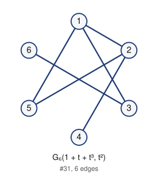

- edges (6): 12 13 15 24 25 36
- degree sequence: 3 3 2 2 1 1
- graph6: `Eqo_`
- labeled Riordan graphs in this class: 5
- complement is Riordan: yes

Riordan matrix B = [ [t^i] g f^j ] (rows i = 0..4)      adjacency matrix A (lower triangle, rows 2..6)

```
1                  2: 1
1 0                3: 1 0
0 1 0              4: 0 1 0
1 1 0 0            5: 1 1 0 0
0 0 1 0 0          6: 0 0 1 0 0
```

## 32. G_6(1 + t^2 + t^4, t^2)

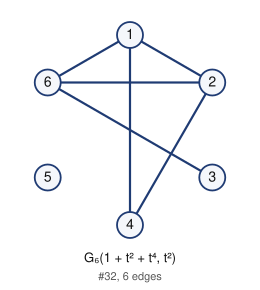

- edges (6): 12 14 16 24 26 36
- degree sequence: 3 3 3 2 1 0
- graph6: `EeB_`
- labeled Riordan graphs in this class: 2
- complement is Riordan: yes

Riordan matrix B = [ [t^i] g f^j ] (rows i = 0..4)      adjacency matrix A (lower triangle, rows 2..6)

```
1                  2: 1
0 0                3: 0 0
1 1 0              4: 1 1 0
0 0 0 0            5: 0 0 0 0
1 1 1 0 0          6: 1 1 1 0 0
```

## 33. G_6(t + t^2, t + t^2 + t^3)

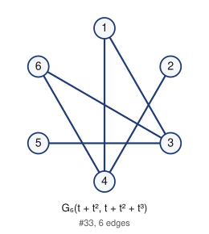

- edges (6): 13 14 24 35 36 46
- degree sequence: 3 3 2 2 1 1
- graph6: `EUGo`
- labeled Riordan graphs in this class: 1
- complement is Riordan: yes

Riordan matrix B = [ [t^i] g f^j ] (rows i = 0..4)      adjacency matrix A (lower triangle, rows 2..6)

```
0                  2: 0
1 0                3: 1 0
1 1 0              4: 1 1 0
0 0 1 0            5: 0 0 1 0
0 0 1 1 0          6: 0 0 1 1 0
```

## 34. G_6(1 + t + t^2 + t^3, t^3)

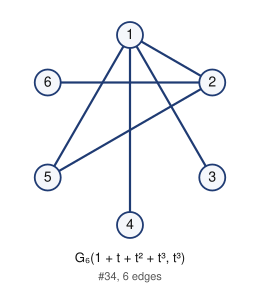

- edges (6): 12 13 14 15 25 26
- degree sequence: 4 3 2 1 1 1
- graph6: `Esp?`
- labeled Riordan graphs in this class: 3
- complement is Riordan: yes

Riordan matrix B = [ [t^i] g f^j ] (rows i = 0..4)      adjacency matrix A (lower triangle, rows 2..6)

```
1                  2: 1
1 0                3: 1 0
1 0 0              4: 1 0 0
1 1 0 0            5: 1 1 0 0
0 1 0 0 0          6: 0 1 0 0 0
```

## 35. G_6(1 + t + t^2, t^2 + t^3 + t^4)

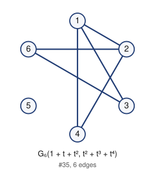

- edges (6): 12 13 14 24 26 36
- degree sequence: 3 3 2 2 2 0
- graph6: `Eu@_`
- labeled Riordan graphs in this class: 1
- complement is Riordan: yes

Riordan matrix B = [ [t^i] g f^j ] (rows i = 0..4)      adjacency matrix A (lower triangle, rows 2..6)

```
1                  2: 1
1 0                3: 1 0
1 1 0              4: 1 1 0
0 0 0 0            5: 0 0 0 0
0 1 1 0 0          6: 0 1 1 0 0
```

## 36. G_6(t + t^2, t)

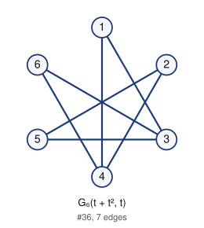

- edges (7): 13 14 24 25 35 36 46
- degree sequence: 3 3 2 2 2 2
- graph6: `EUWo`
- labeled Riordan graphs in this class: 2
- complement is Riordan: yes

Riordan matrix B = [ [t^i] g f^j ] (rows i = 0..4)      adjacency matrix A (lower triangle, rows 2..6)

```
0                  2: 0
1 0                3: 1 0
1 1 0              4: 1 1 0
0 1 1 0            5: 0 1 1 0
0 0 1 1 0          6: 0 0 1 1 0
```

## 37. G_6(1, t + t^3 + t^4)

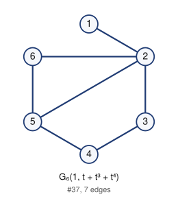

- edges (7): 12 23 25 26 34 45 56
- degree sequence: 4 3 2 2 2 1
- graph6: `EhTG`
- labeled Riordan graphs in this class: 5
- complement is Riordan: yes

Riordan matrix B = [ [t^i] g f^j ] (rows i = 0..4)      adjacency matrix A (lower triangle, rows 2..6)

```
1                  2: 1
0 1                3: 0 1
0 0 1              4: 0 0 1
0 1 0 1            5: 0 1 0 1
0 1 0 0 1          6: 0 1 0 0 1
```

## 38. G_6(1 + t^2, t + t^3)

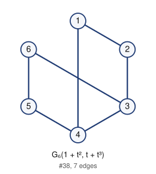

- edges (7): 12 14 23 34 36 45 56
- degree sequence: 3 3 2 2 2 2
- graph6: `ElCg`
- labeled Riordan graphs in this class: 2
- complement is Riordan: yes

Riordan matrix B = [ [t^i] g f^j ] (rows i = 0..4)      adjacency matrix A (lower triangle, rows 2..6)

```
1                  2: 1
0 1                3: 0 1
1 0 1              4: 1 0 1
0 0 0 1            5: 0 0 0 1
0 0 1 0 1          6: 0 0 1 0 1
```

## 39. G_6(t + t^2, t + t^2)

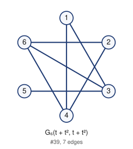

- edges (7): 13 14 24 26 35 36 46
- degree sequence: 3 3 3 2 2 1
- graph6: `EUHo`
- labeled Riordan graphs in this class: 2
- complement is Riordan: yes

Riordan matrix B = [ [t^i] g f^j ] (rows i = 0..4)      adjacency matrix A (lower triangle, rows 2..6)

```
0                  2: 0
1 0                3: 1 0
1 1 0              4: 1 1 0
0 0 1 0            5: 0 0 1 0
0 1 1 1 0          6: 0 1 1 1 0
```

## 40. G_6(t + t^3, t + t^2)

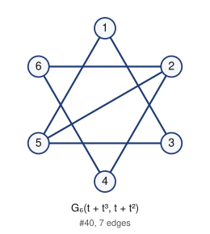

- edges (7): 13 15 24 25 26 35 46
- degree sequence: 3 3 2 2 2 2
- graph6: `EQxO`
- labeled Riordan graphs in this class: 2
- complement is Riordan: yes

Riordan matrix B = [ [t^i] g f^j ] (rows i = 0..4)      adjacency matrix A (lower triangle, rows 2..6)

```
0                  2: 0
1 0                3: 1 0
0 1 0              4: 0 1 0
1 1 1 0            5: 1 1 1 0
0 1 0 1 0          6: 0 1 0 1 0
```

## 41. G_6(1 + t^4, t + t^4)

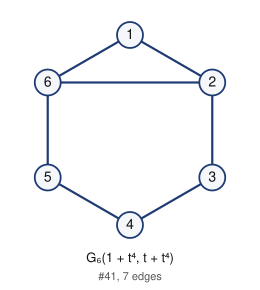

- edges (7): 12 16 23 26 34 45 56
- degree sequence: 3 3 2 2 2 2
- graph6: `EhFG`
- labeled Riordan graphs in this class: 4
- complement is Riordan: yes

Riordan matrix B = [ [t^i] g f^j ] (rows i = 0..4)      adjacency matrix A (lower triangle, rows 2..6)

```
1                  2: 1
0 1                3: 0 1
0 0 1              4: 0 0 1
0 0 0 1            5: 0 0 0 1
1 1 0 0 1          6: 1 1 0 0 1
```

## 42. G_6(1 + t + t^4, t^2 + t^4)

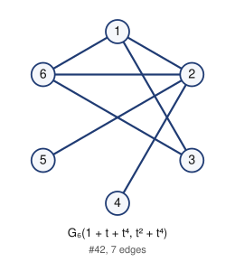

- edges (7): 12 13 16 24 25 26 36
- degree sequence: 4 3 3 2 1 1
- graph6: `EqR_`
- labeled Riordan graphs in this class: 1
- complement is Riordan: yes

Riordan matrix B = [ [t^i] g f^j ] (rows i = 0..4)      adjacency matrix A (lower triangle, rows 2..6)

```
1                  2: 1
1 0                3: 1 0
0 1 0              4: 0 1 0
0 1 0 0            5: 0 1 0 0
1 1 1 0 0          6: 1 1 1 0 0
```

## 43. G_6(1 + t^2 + t^4, t^2 + t^3)

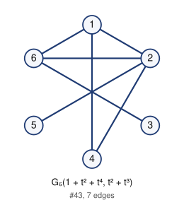

- edges (7): 12 14 16 24 25 26 36
- degree sequence: 4 3 3 2 1 1
- graph6: `EeR_`
- labeled Riordan graphs in this class: 4
- complement is Riordan: yes

Riordan matrix B = [ [t^i] g f^j ] (rows i = 0..4)      adjacency matrix A (lower triangle, rows 2..6)

```
1                  2: 1
0 0                3: 0 0
1 1 0              4: 1 1 0
0 1 0 0            5: 0 1 0 0
1 1 1 0 0          6: 1 1 1 0 0
```

## 44. G_6(t + t^2 + t^4, t + t^2 + t^3)

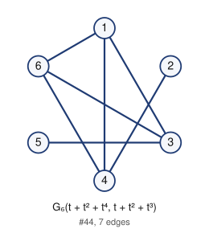

- edges (7): 13 14 16 24 35 36 46
- degree sequence: 3 3 3 3 1 1
- graph6: `EUIo`
- labeled Riordan graphs in this class: 1
- complement is Riordan: yes

Riordan matrix B = [ [t^i] g f^j ] (rows i = 0..4)      adjacency matrix A (lower triangle, rows 2..6)

```
0                  2: 0
1 0                3: 1 0
1 1 0              4: 1 1 0
0 0 1 0            5: 0 0 1 0
1 0 1 1 0          6: 1 0 1 1 0
```

## 45. G_6(1 + t + t^2 + t^4, t^2 + t^3 + t^4)

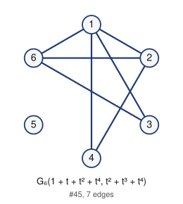

- edges (7): 12 13 14 16 24 26 36
- degree sequence: 4 3 3 2 2 0
- graph6: `EuB_`
- labeled Riordan graphs in this class: 1
- complement is Riordan: yes

Riordan matrix B = [ [t^i] g f^j ] (rows i = 0..4)      adjacency matrix A (lower triangle, rows 2..6)

```
1                  2: 1
1 0                3: 1 0
1 1 0              4: 1 1 0
0 0 0 0            5: 0 0 0 0
1 1 1 0 0          6: 1 1 1 0 0
```

## 46. G_6(1, t + t^2)

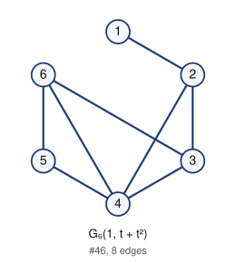

- edges (8): 12 23 24 34 36 45 46 56
- degree sequence: 4 3 3 3 2 1
- graph6: `EjCw`
- labeled Riordan graphs in this class: 4
- complement is Riordan: yes

Riordan matrix B = [ [t^i] g f^j ] (rows i = 0..4)      adjacency matrix A (lower triangle, rows 2..6)

```
1                  2: 1
0 1                3: 0 1
0 1 1              4: 0 1 1
0 0 0 1            5: 0 0 0 1
0 0 1 1 1          6: 0 0 1 1 1
```

## 47. G_6(1 + t^2, t)

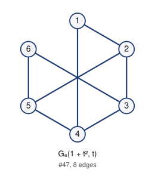

- edges (8): 12 14 23 25 34 36 45 56
- degree sequence: 3 3 3 3 2 2
- graph6: `ElSg`
- labeled Riordan graphs in this class: 2
- complement is Riordan: yes

Riordan matrix B = [ [t^i] g f^j ] (rows i = 0..4)      adjacency matrix A (lower triangle, rows 2..6)

```
1                  2: 1
0 1                3: 0 1
1 0 1              4: 1 0 1
0 1 0 1            5: 0 1 0 1
0 0 1 0 1          6: 0 0 1 0 1
```

## 48. G_6(t + t^2, t + t^3)

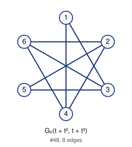

- edges (8): 13 14 24 25 26 35 36 46
- degree sequence: 3 3 3 3 2 2
- graph6: `EUXo`
- labeled Riordan graphs in this class: 4
- complement is Riordan: yes

Riordan matrix B = [ [t^i] g f^j ] (rows i = 0..4)      adjacency matrix A (lower triangle, rows 2..6)

```
0                  2: 0
1 0                3: 1 0
1 1 0              4: 1 1 0
0 1 1 0            5: 0 1 1 0
0 1 1 1 0          6: 0 1 1 1 0
```

## 49. G_6(1 + t^3, t + t^3)

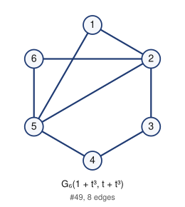

- edges (8): 12 15 23 25 26 34 45 56
- degree sequence: 4 4 2 2 2 2
- graph6: `EhtG`
- labeled Riordan graphs in this class: 2
- complement is Riordan: yes

Riordan matrix B = [ [t^i] g f^j ] (rows i = 0..4)      adjacency matrix A (lower triangle, rows 2..6)

```
1                  2: 1
0 1                3: 0 1
0 0 1              4: 0 0 1
1 1 0 1            5: 1 1 0 1
0 1 0 0 1          6: 0 1 0 0 1
```

## 50. G_6(t + t^2 + t^4, t)

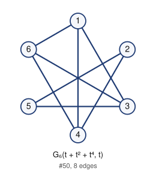

- edges (8): 13 14 16 24 25 35 36 46
- degree sequence: 3 3 3 3 2 2
- graph6: `EUYo`
- labeled Riordan graphs in this class: 2
- complement is Riordan: yes

Riordan matrix B = [ [t^i] g f^j ] (rows i = 0..4)      adjacency matrix A (lower triangle, rows 2..6)

```
0                  2: 0
1 0                3: 1 0
1 1 0              4: 1 1 0
0 1 1 0            5: 0 1 1 0
1 0 1 1 0          6: 1 0 1 1 0
```

## 51. G_6(1 + t^4, t + t^3 + t^4)

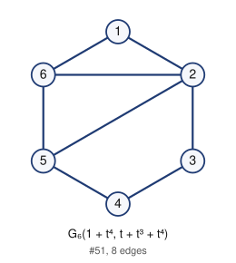

- edges (8): 12 16 23 25 26 34 45 56
- degree sequence: 4 3 3 2 2 2
- graph6: `EhVG`
- labeled Riordan graphs in this class: 2
- complement is Riordan: yes

Riordan matrix B = [ [t^i] g f^j ] (rows i = 0..4)      adjacency matrix A (lower triangle, rows 2..6)

```
1                  2: 1
0 1                3: 0 1
0 0 1              4: 0 0 1
0 1 0 1            5: 0 1 0 1
1 1 0 0 1          6: 1 1 0 0 1
```

## 52. G_6(1 + t + t^2 + t^4, t^2)


- edges (8): 12 13 14 16 24 25 26 36
- degree sequence: 4 4 3 2 2 1
- graph6: `EuR_`
- labeled Riordan graphs in this class: 2
- complement is Riordan: yes

Riordan matrix B = [ [t^i] g f^j ] (rows i = 0..4)      adjacency matrix A (lower triangle, rows 2..6)

```
1                  2: 1
1 0                3: 1 0
1 1 0              4: 1 1 0
0 1 0 0            5: 0 1 0 0
1 1 1 0 0          6: 1 1 1 0 0
```

## 53. G_6(t + t^3 + t^4, t + t^2)


- edges (8): 13 15 16 24 25 26 35 46
- degree sequence: 3 3 3 3 2 2
- graph6: `EQzO`
- labeled Riordan graphs in this class: 2
- complement is Riordan: yes

Riordan matrix B = [ [t^i] g f^j ] (rows i = 0..4)      adjacency matrix A (lower triangle, rows 2..6)

```
0                  2: 0
1 0                3: 1 0
0 1 0              4: 0 1 0
1 1 1 0            5: 1 1 1 0
1 1 0 1 0          6: 1 1 0 1 0
```

## 54. G_6(1 + t^2 + t^3 + t^4, t^2 + t^3)


- edges (8): 12 14 15 16 24 25 26 36
- degree sequence: 4 4 3 2 2 1
- graph6: `Eer_`
- labeled Riordan graphs in this class: 1
- complement is Riordan: yes

Riordan matrix B = [ [t^i] g f^j ] (rows i = 0..4)      adjacency matrix A (lower triangle, rows 2..6)

```
1                  2: 1
0 0                3: 0 0
1 1 0              4: 1 1 0
1 1 0 0            5: 1 1 0 0
1 1 1 0 0          6: 1 1 1 0 0
```

## 55. G_6(1 + t + t^2 + t^3 + t^4, t^2 + t^3 + t^4)


- edges (8): 12 13 14 15 16 24 26 36
- degree sequence: 5 3 3 2 2 1
- graph6: `Eub_`
- labeled Riordan graphs in this class: 1
- complement is Riordan: yes

Riordan matrix B = [ [t^i] g f^j ] (rows i = 0..4)      adjacency matrix A (lower triangle, rows 2..6)

```
1                  2: 1
1 0                3: 1 0
1 1 0              4: 1 1 0
1 0 0 0            5: 1 0 0 0
1 1 1 0 0          6: 1 1 1 0 0
```

## 56. G_6(1 + t, t)


- edges (9): 12 13 23 24 34 35 45 46 56
- degree sequence: 4 4 3 3 2 2
- graph6: `EzKW`
- labeled Riordan graphs in this class: 2
- complement is Riordan: yes

Riordan matrix B = [ [t^i] g f^j ] (rows i = 0..4)      adjacency matrix A (lower triangle, rows 2..6)

```
1                  2: 1
1 1                3: 1 1
0 1 1              4: 0 1 1
0 0 1 1            5: 0 0 1 1
0 0 0 1 1          6: 0 0 0 1 1
```

## 57. G_6(1, t + t^2 + t^3)


- edges (9): 12 23 24 25 34 36 45 46 56
- degree sequence: 4 4 3 3 3 1
- graph6: `EjSw`
- labeled Riordan graphs in this class: 2
- complement is Riordan: yes

Riordan matrix B = [ [t^i] g f^j ] (rows i = 0..4)      adjacency matrix A (lower triangle, rows 2..6)

```
1                  2: 1
0 1                3: 0 1
0 1 1              4: 0 1 1
0 1 0 1            5: 0 1 0 1
0 0 1 1 1          6: 0 0 1 1 1
```

## 58. G_6(1, t + t^2 + t^4)


- edges (9): 12 23 24 26 34 36 45 46 56
- degree sequence: 4 4 4 3 2 1
- graph6: `EjDw`
- labeled Riordan graphs in this class: 2
- complement is Riordan: yes

Riordan matrix B = [ [t^i] g f^j ] (rows i = 0..4)      adjacency matrix A (lower triangle, rows 2..6)

```
1                  2: 1
0 1                3: 0 1
0 1 1              4: 0 1 1
0 0 0 1            5: 0 0 0 1
0 1 1 1 1          6: 0 1 1 1 1
```

## 59. G_6(1 + t, t + t^2)


- edges (9): 12 13 23 25 34 35 36 45 56
- degree sequence: 5 4 3 2 2 2
- graph6: `Ex[g`
- labeled Riordan graphs in this class: 5
- complement is Riordan: yes

Riordan matrix B = [ [t^i] g f^j ] (rows i = 0..4)      adjacency matrix A (lower triangle, rows 2..6)

```
1                  2: 1
1 1                3: 1 1
0 0 1              4: 0 0 1
0 1 1 1            5: 0 1 1 1
0 0 1 0 1          6: 0 0 1 0 1
```

## 60. G_6(1 + t^2, t + t^4)


- edges (9): 12 14 23 25 26 34 36 45 56
- degree sequence: 4 3 3 3 3 2
- graph6: `ElTg`
- labeled Riordan graphs in this class: 4
- complement is Riordan: yes

Riordan matrix B = [ [t^i] g f^j ] (rows i = 0..4)      adjacency matrix A (lower triangle, rows 2..6)

```
1                  2: 1
0 1                3: 0 1
1 0 1              4: 1 0 1
0 1 0 1            5: 0 1 0 1
0 1 1 0 1          6: 0 1 1 0 1
```

## 61. G_6(t + t^2 + t^3, t)


- edges (9): 13 14 15 24 25 26 35 36 46
- degree sequence: 3 3 3 3 3 3
- graph6: `EUxo`
- labeled Riordan graphs in this class: 2
- complement is Riordan: yes

Riordan matrix B = [ [t^i] g f^j ] (rows i = 0..4)      adjacency matrix A (lower triangle, rows 2..6)

```
0                  2: 0
1 0                3: 1 0
1 1 0              4: 1 1 0
1 1 1 0            5: 1 1 1 0
0 1 1 1 0          6: 0 1 1 1 0
```

## 62. G_6(1 + t^4, t + t^2)


- edges (9): 12 16 23 24 34 36 45 46 56
- degree sequence: 4 4 3 3 2 2
- graph6: `EjEw`
- labeled Riordan graphs in this class: 2
- complement is Riordan: yes

Riordan matrix B = [ [t^i] g f^j ] (rows i = 0..4)      adjacency matrix A (lower triangle, rows 2..6)

```
1                  2: 1
0 1                3: 0 1
0 1 1              4: 0 1 1
0 0 0 1            5: 0 0 0 1
1 0 1 1 1          6: 1 0 1 1 1
```

## 63. G_6(1 + t^2 + t^4, t)


- edges (9): 12 14 16 23 25 34 36 45 56
- degree sequence: 3 3 3 3 3 3
- graph6: `ElUg`
- labeled Riordan graphs in this class: 1
- complement is Riordan: yes

Riordan matrix B = [ [t^i] g f^j ] (rows i = 0..4)      adjacency matrix A (lower triangle, rows 2..6)

```
1                  2: 1
0 1                3: 0 1
1 0 1              4: 1 0 1
0 1 0 1            5: 0 1 0 1
1 0 1 0 1          6: 1 0 1 0 1
```

## 64. G_6(1 + t, t + t^2 + t^3)


- edges (9): 12 13 23 26 34 35 36 45 56
- degree sequence: 5 3 3 3 2 2
- graph6: `ExLg`
- labeled Riordan graphs in this class: 4
- complement is Riordan: yes

Riordan matrix B = [ [t^i] g f^j ] (rows i = 0..4)      adjacency matrix A (lower triangle, rows 2..6)

```
1                  2: 1
1 1                3: 1 1
0 0 1              4: 0 0 1
0 0 1 1            5: 0 0 1 1
0 1 1 0 1          6: 0 1 1 0 1
```

## 65. G_6(1 + t + t^2, t + t^2)


- edges (9): 12 13 14 23 26 34 35 45 56
- degree sequence: 4 3 3 3 3 2
- graph6: `E|LG`
- labeled Riordan graphs in this class: 4
- complement is Riordan: yes

Riordan matrix B = [ [t^i] g f^j ] (rows i = 0..4)      adjacency matrix A (lower triangle, rows 2..6)

```
1                  2: 1
1 1                3: 1 1
1 0 1              4: 1 0 1
0 0 1 1            5: 0 0 1 1
0 1 0 0 1          6: 0 1 0 0 1
```

## 66. G_6(1 + t^3 + t^4, t + t^3)


- edges (9): 12 15 16 23 25 26 34 45 56
- degree sequence: 4 4 3 3 2 2
- graph6: `EhvG`
- labeled Riordan graphs in this class: 1
- complement is Riordan: yes

Riordan matrix B = [ [t^i] g f^j ] (rows i = 0..4)      adjacency matrix A (lower triangle, rows 2..6)

```
1                  2: 1
0 1                3: 0 1
0 0 1              4: 0 0 1
1 1 0 1            5: 1 1 0 1
1 1 0 0 1          6: 1 1 0 0 1
```

## 67. G_6(1 + t, t + t^4)


- edges (10): 12 13 23 24 26 34 35 45 46 56
- degree sequence: 4 4 4 3 3 2
- graph6: `EzLW`
- labeled Riordan graphs in this class: 4
- complement is Riordan: yes

Riordan matrix B = [ [t^i] g f^j ] (rows i = 0..4)      adjacency matrix A (lower triangle, rows 2..6)

```
1                  2: 1
1 1                3: 1 1
0 1 1              4: 0 1 1
0 0 1 1            5: 0 0 1 1
0 1 0 1 1          6: 0 1 0 1 1
```

## 68. G_6(1 + t^2, t + t^2)


- edges (10): 12 14 23 24 25 26 34 45 46 56
- degree sequence: 5 5 3 3 2 2
- graph6: `EnTW`
- labeled Riordan graphs in this class: 2
- complement is Riordan: yes

Riordan matrix B = [ [t^i] g f^j ] (rows i = 0..4)      adjacency matrix A (lower triangle, rows 2..6)

```
1                  2: 1
0 1                3: 0 1
1 1 1              4: 1 1 1
0 1 0 1            5: 0 1 0 1
0 1 0 1 1          6: 0 1 0 1 1
```

## 69. G_6(1 + t^3, t + t^2)


- edges (10): 12 15 23 24 26 34 36 45 46 56
- degree sequence: 4 4 4 3 3 2
- graph6: `Ejdw`
- labeled Riordan graphs in this class: 2
- complement is Riordan: yes

Riordan matrix B = [ [t^i] g f^j ] (rows i = 0..4)      adjacency matrix A (lower triangle, rows 2..6)

```
1                  2: 1
0 1                3: 0 1
0 1 1              4: 0 1 1
1 0 0 1            5: 1 0 0 1
0 1 1 1 1          6: 0 1 1 1 1
```

## 70. G_6(1 + t^2 + t^3, t)


- edges (10): 12 14 15 23 25 26 34 36 45 56
- degree sequence: 4 4 3 3 3 3
- graph6: `Eltg`
- labeled Riordan graphs in this class: 6
- complement is Riordan: yes

Riordan matrix B = [ [t^i] g f^j ] (rows i = 0..4)      adjacency matrix A (lower triangle, rows 2..6)

```
1                  2: 1
0 1                3: 0 1
1 0 1              4: 1 0 1
1 1 0 1            5: 1 1 0 1
0 1 1 0 1          6: 0 1 1 0 1
```

## 71. G_6(1, t + t^2 + t^3 + t^4)


- edges (10): 12 23 24 25 26 34 36 45 46 56
- degree sequence: 5 4 4 3 3 1
- graph6: `EjTw`
- labeled Riordan graphs in this class: 2
- complement is Riordan: yes

Riordan matrix B = [ [t^i] g f^j ] (rows i = 0..4)      adjacency matrix A (lower triangle, rows 2..6)

```
1                  2: 1
0 1                3: 0 1
0 1 1              4: 0 1 1
0 1 0 1            5: 0 1 0 1
0 1 1 1 1          6: 0 1 1 1 1
```

## 72. G_6(1 + t, t + t^2 + t^4)


- edges (10): 12 13 23 25 26 34 35 36 45 56
- degree sequence: 5 4 4 3 2 2
- graph6: `Ex\g`
- labeled Riordan graphs in this class: 6
- complement is Riordan: yes

Riordan matrix B = [ [t^i] g f^j ] (rows i = 0..4)      adjacency matrix A (lower triangle, rows 2..6)

```
1                  2: 1
1 1                3: 1 1
0 0 1              4: 0 0 1
0 1 1 1            5: 0 1 1 1
0 1 1 0 1          6: 0 1 1 0 1
```

## 73. G_6(1 + t, t + t^3 + t^4)


- edges (10): 12 13 23 24 25 34 35 45 46 56
- degree sequence: 4 4 4 4 2 2
- graph6: `Ez[W`
- labeled Riordan graphs in this class: 1
- complement is Riordan: yes

Riordan matrix B = [ [t^i] g f^j ] (rows i = 0..4)      adjacency matrix A (lower triangle, rows 2..6)

```
1                  2: 1
1 1                3: 1 1
0 1 1              4: 0 1 1
0 1 1 1            5: 0 1 1 1
0 0 0 1 1          6: 0 0 0 1 1
```

## 74. G_6(1 + t^4, t + t^2 + t^3)


- edges (10): 12 16 23 24 25 34 36 45 46 56
- degree sequence: 4 4 4 3 3 2
- graph6: `EjUw`
- labeled Riordan graphs in this class: 2
- complement is Riordan: yes

Riordan matrix B = [ [t^i] g f^j ] (rows i = 0..4)      adjacency matrix A (lower triangle, rows 2..6)

```
1                  2: 1
0 1                3: 0 1
0 1 1              4: 0 1 1
0 1 0 1            5: 0 1 0 1
1 0 1 1 1          6: 1 0 1 1 1
```

## 75. G_6(1 + t + t^4, t + t^2)


- edges (10): 12 13 16 23 25 34 35 36 45 56
- degree sequence: 5 4 3 3 3 2
- graph6: `Ex]g`
- labeled Riordan graphs in this class: 4
- complement is Riordan: yes

Riordan matrix B = [ [t^i] g f^j ] (rows i = 0..4)      adjacency matrix A (lower triangle, rows 2..6)

```
1                  2: 1
1 1                3: 1 1
0 0 1              4: 0 0 1
0 1 1 1            5: 0 1 1 1
1 0 1 0 1          6: 1 0 1 0 1
```

## 76. G_6(1 + t^2 + t^4, t + t^4)


- edges (10): 12 14 16 23 25 26 34 36 45 56
- degree sequence: 4 4 3 3 3 3
- graph6: `ElVg`
- labeled Riordan graphs in this class: 2
- complement is Riordan: yes

Riordan matrix B = [ [t^i] g f^j ] (rows i = 0..4)      adjacency matrix A (lower triangle, rows 2..6)

```
1                  2: 1
0 1                3: 0 1
1 0 1              4: 1 0 1
0 1 0 1            5: 0 1 0 1
1 1 1 0 1          6: 1 1 1 0 1
```

## 77. G_6(1 + t + t^4, t + t^2 + t^3)


- edges (10): 12 13 16 23 26 34 35 36 45 56
- degree sequence: 5 4 3 3 3 2
- graph6: `ExNg`
- labeled Riordan graphs in this class: 2
- complement is Riordan: yes

Riordan matrix B = [ [t^i] g f^j ] (rows i = 0..4)      adjacency matrix A (lower triangle, rows 2..6)

```
1                  2: 1
1 1                3: 1 1
0 0 1              4: 0 0 1
0 0 1 1            5: 0 0 1 1
1 1 1 0 1          6: 1 1 1 0 1
```

## 78. G_6(1 + t, t + t^3)


- edges (11): 12 13 23 24 25 26 34 35 45 46 56
- degree sequence: 5 4 4 4 3 2
- graph6: `Ez\W`
- labeled Riordan graphs in this class: 8
- complement is Riordan: yes

Riordan matrix B = [ [t^i] g f^j ] (rows i = 0..4)      adjacency matrix A (lower triangle, rows 2..6)

```
1                  2: 1
1 1                3: 1 1
0 1 1              4: 0 1 1
0 1 1 1            5: 0 1 1 1
0 1 0 1 1          6: 0 1 0 1 1
```

## 79. G_6(1 + t + t^3, t)


- edges (11): 12 13 15 23 24 26 34 35 45 46 56
- degree sequence: 4 4 4 4 3 3
- graph6: `EzlW`
- labeled Riordan graphs in this class: 5
- complement is Riordan: yes

Riordan matrix B = [ [t^i] g f^j ] (rows i = 0..4)      adjacency matrix A (lower triangle, rows 2..6)

```
1                  2: 1
1 1                3: 1 1
0 1 1              4: 0 1 1
1 0 1 1            5: 1 0 1 1
0 1 0 1 1          6: 0 1 0 1 1
```

## 80. G_6(1 + t + t^3, t + t^2)


- edges (11): 12 13 15 23 25 26 34 35 36 45 56
- degree sequence: 5 5 4 3 3 2
- graph6: `Ex|g`
- labeled Riordan graphs in this class: 6
- complement is Riordan: yes

Riordan matrix B = [ [t^i] g f^j ] (rows i = 0..4)      adjacency matrix A (lower triangle, rows 2..6)

```
1                  2: 1
1 1                3: 1 1
0 0 1              4: 0 0 1
1 1 1 1            5: 1 1 1 1
0 1 1 0 1          6: 0 1 1 0 1
```

## 81. G_6(1 + t^3 + t^4, t + t^2)


- edges (11): 12 15 16 23 24 26 34 36 45 46 56
- degree sequence: 5 4 4 3 3 3
- graph6: `Ejfw`
- labeled Riordan graphs in this class: 2
- complement is Riordan: yes

Riordan matrix B = [ [t^i] g f^j ] (rows i = 0..4)      adjacency matrix A (lower triangle, rows 2..6)

```
1                  2: 1
0 1                3: 0 1
0 1 1              4: 0 1 1
1 0 0 1            5: 1 0 0 1
1 1 1 1 1          6: 1 1 1 1 1
```

## 82. G_6(1 + t^2 + t^3 + t^4, t)


- edges (11): 12 14 15 16 23 25 26 34 36 45 56
- degree sequence: 4 4 4 4 3 3
- graph6: `Elvg`
- labeled Riordan graphs in this class: 2
- complement is Riordan: yes

Riordan matrix B = [ [t^i] g f^j ] (rows i = 0..4)      adjacency matrix A (lower triangle, rows 2..6)

```
1                  2: 1
0 1                3: 0 1
1 0 1              4: 1 0 1
1 1 0 1            5: 1 1 0 1
1 1 1 0 1          6: 1 1 1 0 1
```

## 83. G_6(1 + t + t^2, t)


- edges (12): 12 13 14 23 24 25 34 35 36 45 46 56
- degree sequence: 5 5 4 4 3 3
- graph6: `E~[w`
- labeled Riordan graphs in this class: 7
- complement is Riordan: yes

Riordan matrix B = [ [t^i] g f^j ] (rows i = 0..4)      adjacency matrix A (lower triangle, rows 2..6)

```
1                  2: 1
1 1                3: 1 1
1 1 1              4: 1 1 1
0 1 1 1            5: 0 1 1 1
0 0 1 1 1          6: 0 0 1 1 1
```

## 84. G_6(1 + t + t^4, t + t^3)


- edges (12): 12 13 16 23 24 25 26 34 35 45 46 56
- degree sequence: 5 4 4 4 4 3
- graph6: `Ez^W`
- labeled Riordan graphs in this class: 2
- complement is Riordan: yes

Riordan matrix B = [ [t^i] g f^j ] (rows i = 0..4)      adjacency matrix A (lower triangle, rows 2..6)

```
1                  2: 1
1 1                3: 1 1
0 1 1              4: 0 1 1
0 1 1 1            5: 0 1 1 1
1 1 0 1 1          6: 1 1 0 1 1
```

## 85. G_6(1 + t + t^3 + t^4, t)


- edges (12): 12 13 15 16 23 24 26 34 35 45 46 56
- degree sequence: 4 4 4 4 4 4
- graph6: `EznW`
- labeled Riordan graphs in this class: 1
- complement is Riordan: yes

Riordan matrix B = [ [t^i] g f^j ] (rows i = 0..4)      adjacency matrix A (lower triangle, rows 2..6)

```
1                  2: 1
1 1                3: 1 1
0 1 1              4: 0 1 1
1 0 1 1            5: 1 0 1 1
1 1 0 1 1          6: 1 1 0 1 1
```

## 86. G_6(1 + t + t^3 + t^4, t + t^2)


- edges (12): 12 13 15 16 23 25 26 34 35 36 45 56
- degree sequence: 5 5 4 4 4 2
- graph6: `Ex~g`
- labeled Riordan graphs in this class: 2
- complement is Riordan: yes

Riordan matrix B = [ [t^i] g f^j ] (rows i = 0..4)      adjacency matrix A (lower triangle, rows 2..6)

```
1                  2: 1
1 1                3: 1 1
0 0 1              4: 0 0 1
1 1 1 1            5: 1 1 1 1
1 1 1 0 1          6: 1 1 1 0 1
```

## 87. G_6(1 + t + t^2, t + t^4)


- edges (13): 12 13 14 23 24 25 26 34 35 36 45 46 56
- degree sequence: 5 5 5 4 4 3
- graph6: `E~\w`
- labeled Riordan graphs in this class: 4
- complement is Riordan: yes

Riordan matrix B = [ [t^i] g f^j ] (rows i = 0..4)      adjacency matrix A (lower triangle, rows 2..6)

```
1                  2: 1
1 1                3: 1 1
1 1 1              4: 1 1 1
0 1 1 1            5: 0 1 1 1
0 1 1 1 1          6: 0 1 1 1 1
```

## 88. G_6(1 + t + t^2 + t^4, t)


- edges (13): 12 13 14 16 23 24 25 34 35 36 45 46 56
- degree sequence: 5 5 4 4 4 4
- graph6: `E~]w`
- labeled Riordan graphs in this class: 3
- complement is Riordan: yes

Riordan matrix B = [ [t^i] g f^j ] (rows i = 0..4)      adjacency matrix A (lower triangle, rows 2..6)

```
1                  2: 1
1 1                3: 1 1
1 1 1              4: 1 1 1
0 1 1 1            5: 0 1 1 1
1 0 1 1 1          6: 1 0 1 1 1
```

## 89. G_6(1 + t + t^2 + t^3, t)


- edges (14): 12 13 14 15 23 24 25 26 34 35 36 45 46 56
- degree sequence: 5 5 5 5 4 4
- graph6: `E~|w`
- labeled Riordan graphs in this class: 4
- complement is Riordan: yes

Riordan matrix B = [ [t^i] g f^j ] (rows i = 0..4)      adjacency matrix A (lower triangle, rows 2..6)

```
1                  2: 1
1 1                3: 1 1
1 1 1              4: 1 1 1
1 1 1 1            5: 1 1 1 1
0 1 1 1 1          6: 0 1 1 1 1
```

## 90. G_6(1 + t + t^2 + t^3 + t^4, t)


- edges (15): 12 13 14 15 16 23 24 25 26 34 35 36 45 46 56
- degree sequence: 5 5 5 5 5 5
- graph6: `E~~w`
- labeled Riordan graphs in this class: 1
- complement is Riordan: yes

Riordan matrix B = [ [t^i] g f^j ] (rows i = 0..4)      adjacency matrix A (lower triangle, rows 2..6)

```
1                  2: 1
1 1                3: 1 1
1 1 1              4: 1 1 1
1 1 1 1            5: 1 1 1 1
1 1 1 1 1          6: 1 1 1 1 1
```

