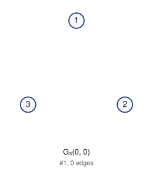
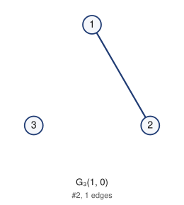
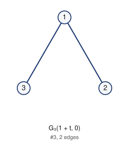
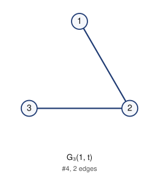
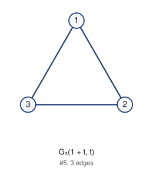
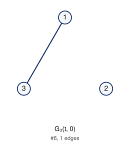

# Labeled Riordan graphs of order 3 (filter: all): 6

## 1. G_3(0, 0)



- edges (0): 
- degree sequence: 0 0 0
- graph6: `B?`
- complement is a labeled Riordan graph (same labeling): yes

Riordan matrix B = [ [t^i] g f^j ] (rows i = 0..1)      adjacency matrix A (lower triangle, rows 2..3)

```
0            2: 0
0 0          3: 0 0
```

## 2. G_3(1, 0)



- edges (1): 12
- degree sequence: 1 1 0
- graph6: `B_`
- complement is a labeled Riordan graph (same labeling): no

Riordan matrix B = [ [t^i] g f^j ] (rows i = 0..1)      adjacency matrix A (lower triangle, rows 2..3)

```
1            2: 1
0 0          3: 0 0
```

## 3. G_3(1 + t, 0)



- edges (2): 12 13
- degree sequence: 2 1 1
- graph6: `Bo`
- complement is a labeled Riordan graph (same labeling): no

Riordan matrix B = [ [t^i] g f^j ] (rows i = 0..1)      adjacency matrix A (lower triangle, rows 2..3)

```
1            2: 1
1 0          3: 1 0
```

## 4. G_3(1, t)



- edges (2): 12 23
- degree sequence: 2 1 1
- graph6: `Bg`
- complement is a labeled Riordan graph (same labeling): yes

Riordan matrix B = [ [t^i] g f^j ] (rows i = 0..1)      adjacency matrix A (lower triangle, rows 2..3)

```
1            2: 1
0 1          3: 0 1
```

## 5. G_3(1 + t, t)



- edges (3): 12 13 23
- degree sequence: 2 2 2
- graph6: `Bw`
- complement is a labeled Riordan graph (same labeling): yes

Riordan matrix B = [ [t^i] g f^j ] (rows i = 0..1)      adjacency matrix A (lower triangle, rows 2..3)

```
1            2: 1
1 1          3: 1 1
```

## 6. G_3(t, 0)



- edges (1): 13
- degree sequence: 1 1 0
- graph6: `BO`
- complement is a labeled Riordan graph (same labeling): yes

Riordan matrix B = [ [t^i] g f^j ] (rows i = 0..1)      adjacency matrix A (lower triangle, rows 2..3)

```
0            2: 0
1 0          3: 1 0
```

