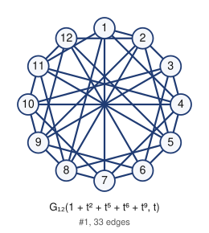
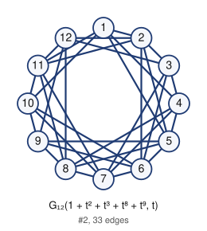

# Unlabeled Riordan graphs of order 12 (filter: selfcomplementary): 2

## 1. G_12(1 + t^2 + t^5 + t^6 + t^9, t)



- edges (33): 12 14 17 18 111 23 25 28 29 212 34 36 39 310 45 47 410 411 56 58 511 512 67 69 612 78 710 89 811 910 912 1011 1112
- degree sequence: 6 6 6 6 6 6 5 5 5 5 5 5
- graph6: `KlSkmTdKkqhd`
- labeled Riordan graphs in this class: 6
- complement is Riordan: yes (self-complementary)

Riordan matrix B = [ [t^i] g f^j ] (rows i = 0..10)      adjacency matrix A (lower triangle, rows 2..12)

```
1                              2: 1
0 1                            3: 0 1
1 0 1                          4: 1 0 1
0 1 0 1                        5: 0 1 0 1
0 0 1 0 1                      6: 0 0 1 0 1
1 0 0 1 0 1                    7: 1 0 0 1 0 1
1 1 0 0 1 0 1                  8: 1 1 0 0 1 0 1
0 1 1 0 0 1 0 1                9: 0 1 1 0 0 1 0 1
0 0 1 1 0 0 1 0 1              10: 0 0 1 1 0 0 1 0 1
1 0 0 1 1 0 0 1 0 1            11: 1 0 0 1 1 0 0 1 0 1
0 1 0 0 1 1 0 0 1 0 1          12: 0 1 0 0 1 1 0 0 1 0 1
```

## 2. G_12(1 + t^2 + t^3 + t^8 + t^9, t)



- edges (33): 12 14 15 110 111 23 25 26 211 212 34 36 37 312 45 47 48 56 58 59 67 69 610 78 710 711 89 811 812 910 912 1011 1112
- degree sequence: 6 6 6 6 6 6 5 5 5 5 5 5
- graph6: `KlthgsL`mEkL`
- labeled Riordan graphs in this class: 2
- complement is Riordan: yes (self-complementary)

Riordan matrix B = [ [t^i] g f^j ] (rows i = 0..10)      adjacency matrix A (lower triangle, rows 2..12)

```
1                              2: 1
0 1                            3: 0 1
1 0 1                          4: 1 0 1
1 1 0 1                        5: 1 1 0 1
0 1 1 0 1                      6: 0 1 1 0 1
0 0 1 1 0 1                    7: 0 0 1 1 0 1
0 0 0 1 1 0 1                  8: 0 0 0 1 1 0 1
0 0 0 0 1 1 0 1                9: 0 0 0 0 1 1 0 1
1 0 0 0 0 1 1 0 1              10: 1 0 0 0 0 1 1 0 1
1 1 0 0 0 0 1 1 0 1            11: 1 1 0 0 0 0 1 1 0 1
0 1 1 0 0 0 0 1 1 0 1          12: 0 1 1 0 0 0 0 1 1 0 1
```

