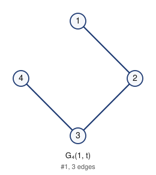

# Unlabeled Riordan graphs of order 4 (filter: selfcomplementary): 1

## 1. G_4(1, t)



- edges (3): 12 23 34
- degree sequence: 2 2 1 1
- graph6: `Ch`
- labeled Riordan graphs in this class: 3
- complement is Riordan: yes (self-complementary)

Riordan matrix B = [ [t^i] g f^j ] (rows i = 0..2)      adjacency matrix A (lower triangle, rows 2..4)

```
1              2: 1
0 1            3: 0 1
0 0 1          4: 0 0 1
```

