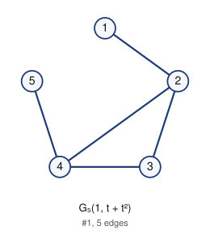
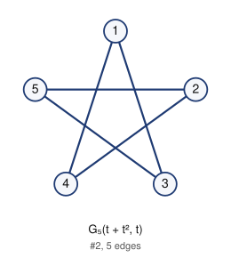

# Unlabeled Riordan graphs of order 5 (filter: selfcomplementary): 2

## 1. G_5(1, t + t^2)



- edges (5): 12 23 24 34 45
- degree sequence: 3 3 2 1 1
- graph6: `DjC`
- labeled Riordan graphs in this class: 3
- complement is Riordan: yes (self-complementary)

Riordan matrix B = [ [t^i] g f^j ] (rows i = 0..3)      adjacency matrix A (lower triangle, rows 2..5)

```
1                2: 1
0 1              3: 0 1
0 1 1            4: 0 1 1
0 0 0 1          5: 0 0 0 1
```

## 2. G_5(t + t^2, t)



- edges (5): 13 14 24 25 35
- degree sequence: 2 2 2 2 2
- graph6: `DUW`
- labeled Riordan graphs in this class: 2
- complement is Riordan: yes (self-complementary)

Riordan matrix B = [ [t^i] g f^j ] (rows i = 0..3)      adjacency matrix A (lower triangle, rows 2..5)

```
0                2: 0
1 0              3: 1 0
1 1 0            4: 1 1 0
0 1 1 0          5: 0 1 1 0
```

