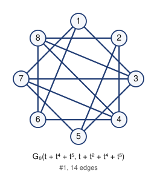

# Unlabeled Riordan graphs of order 8 (filter: selfcomplementary): 1

## 1. G_8(t + t^4 + t^5, t + t^2 + t^4 + t^5)



- edges (14): 13 16 17 24 25 28 35 37 38 46 47 48 57 68
- degree sequence: 4 4 4 4 3 3 3 3
- graph6: `GQYTrg`
- labeled Riordan graphs in this class: 2
- complement is Riordan: yes (self-complementary)

Riordan matrix B = [ [t^i] g f^j ] (rows i = 0..6)      adjacency matrix A (lower triangle, rows 2..8)

```
0                      2: 0
1 0                    3: 1 0
0 1 0                  4: 0 1 0
0 1 1 0                5: 0 1 1 0
1 0 0 1 0              6: 1 0 0 1 0
1 0 1 1 1 0            7: 1 0 1 1 1 0
0 1 1 1 0 1 0          8: 0 1 1 1 0 1 0
```

