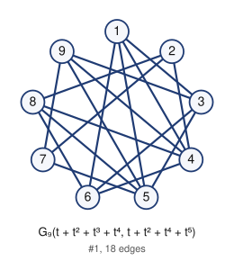

# Unlabeled Riordan graphs of order 9 (filter: selfcomplementary): 1

## 1. G_9(t + t^2 + t^3 + t^4, t + t^2 + t^4 + t^5)



- edges (18): 13 14 15 16 24 27 28 35 36 39 46 48 49 57 58 59 68 79
- degree sequence: 5 5 4 4 4 4 4 3 3
- graph6: `HUiqQwy`
- labeled Riordan graphs in this class: 2
- complement is Riordan: yes (self-complementary)

Riordan matrix B = [ [t^i] g f^j ] (rows i = 0..7)      adjacency matrix A (lower triangle, rows 2..9)

```
0                        2: 0
1 0                      3: 1 0
1 1 0                    4: 1 1 0
1 0 1 0                  5: 1 0 1 0
1 0 1 1 0                6: 1 0 1 1 0
0 1 0 0 1 0              7: 0 1 0 0 1 0
0 1 0 1 1 1 0            8: 0 1 0 1 1 1 0
0 0 1 1 1 0 1 0          9: 0 0 1 1 1 0 1 0
```

