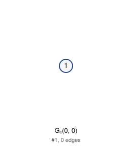

# Unlabeled Riordan graphs of order 1 (filter: all): 1

## 1. G_1(0, 0)

- edges (0): 
- degree sequence: 0
- graph6: `@`
- labeled Riordan graphs in this class: 1
- complement is Riordan: yes (self-complementary)
