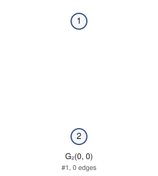
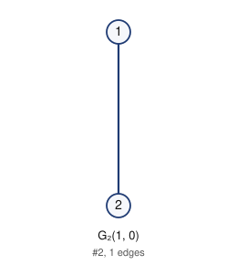

# Unlabeled Riordan graphs of order 2 (filter: all): 2

## 1. G_2(0, 0)



- edges (0): 
- degree sequence: 0 0
- graph6: `A?`
- labeled Riordan graphs in this class: 1
- complement is Riordan: yes

Riordan matrix B = [ [t^i] g f^j ] (rows i = 0..0)      adjacency matrix A (lower triangle, rows 2..2)

```
0          2: 0
```

## 2. G_2(1, 0)



- edges (1): 12
- degree sequence: 1 1
- graph6: `A_`
- labeled Riordan graphs in this class: 1
- complement is Riordan: yes

Riordan matrix B = [ [t^i] g f^j ] (rows i = 0..0)      adjacency matrix A (lower triangle, rows 2..2)

```
1          2: 1
```

