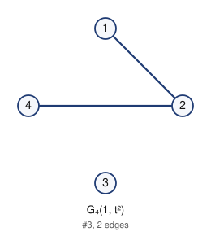
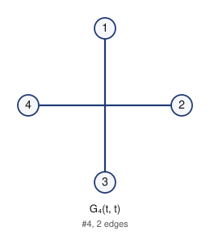
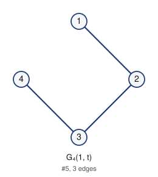
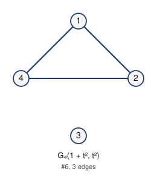
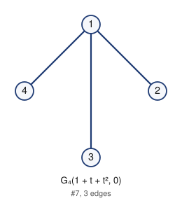
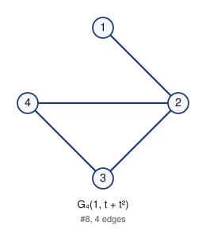
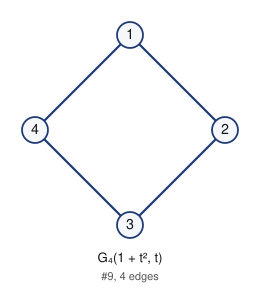
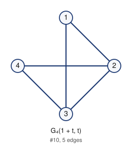
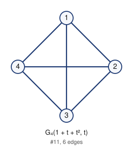

# Unlabeled Riordan graphs of order 4 (filter: all): 11

## 1. G_4(0, 0)


- edges (0): 
- degree sequence: 0 0 0 0
- graph6: `C?`
- labeled Riordan graphs in this class: 1
- complement is Riordan: yes

Riordan matrix B = [ [t^i] g f^j ] (rows i = 0..2)      adjacency matrix A (lower triangle, rows 2..4)

```
0              2: 0
0 0            3: 0 0
0 0 0          4: 0 0 0
```

## 2. G_4(1, 0)


- edges (1): 12
- degree sequence: 1 1 0 0
- graph6: `C_`
- labeled Riordan graphs in this class: 3
- complement is Riordan: yes

Riordan matrix B = [ [t^i] g f^j ] (rows i = 0..2)      adjacency matrix A (lower triangle, rows 2..4)

```
1              2: 1
0 0            3: 0 0
0 0 0          4: 0 0 0
```

## 3. G_4(1, t^2)



- edges (2): 12 24
- degree sequence: 2 1 1 0
- graph6: `Ca`
- labeled Riordan graphs in this class: 4
- complement is Riordan: yes

Riordan matrix B = [ [t^i] g f^j ] (rows i = 0..2)      adjacency matrix A (lower triangle, rows 2..4)

```
1              2: 1
0 0            3: 0 0
0 1 0          4: 0 1 0
```

## 4. G_4(t, t)



- edges (2): 13 24
- degree sequence: 1 1 1 1
- graph6: `CQ`
- labeled Riordan graphs in this class: 1
- complement is Riordan: yes

Riordan matrix B = [ [t^i] g f^j ] (rows i = 0..2)      adjacency matrix A (lower triangle, rows 2..4)

```
0              2: 0
1 0            3: 1 0
0 1 0          4: 0 1 0
```

## 5. G_4(1, t)



- edges (3): 12 23 34
- degree sequence: 2 2 1 1
- graph6: `Ch`
- labeled Riordan graphs in this class: 3
- complement is Riordan: yes (self-complementary)

Riordan matrix B = [ [t^i] g f^j ] (rows i = 0..2)      adjacency matrix A (lower triangle, rows 2..4)

```
1              2: 1
0 1            3: 0 1
0 0 1          4: 0 0 1
```

## 6. G_4(1 + t^2, t^2)



- edges (3): 12 14 24
- degree sequence: 2 2 2 0
- graph6: `Ce`
- labeled Riordan graphs in this class: 1
- complement is Riordan: yes

Riordan matrix B = [ [t^i] g f^j ] (rows i = 0..2)      adjacency matrix A (lower triangle, rows 2..4)

```
1              2: 1
0 0            3: 0 0
1 1 0          4: 1 1 0
```

## 7. G_4(1 + t + t^2, 0)



- edges (3): 12 13 14
- degree sequence: 3 1 1 1
- graph6: `Cs`
- labeled Riordan graphs in this class: 1
- complement is Riordan: yes

Riordan matrix B = [ [t^i] g f^j ] (rows i = 0..2)      adjacency matrix A (lower triangle, rows 2..4)

```
1              2: 1
1 0            3: 1 0
1 0 0          4: 1 0 0
```

## 8. G_4(1, t + t^2)



- edges (4): 12 23 24 34
- degree sequence: 3 2 2 1
- graph6: `Cj`
- labeled Riordan graphs in this class: 3
- complement is Riordan: yes

Riordan matrix B = [ [t^i] g f^j ] (rows i = 0..2)      adjacency matrix A (lower triangle, rows 2..4)

```
1              2: 1
0 1            3: 0 1
0 1 1          4: 0 1 1
```

## 9. G_4(1 + t^2, t)



- edges (4): 12 14 23 34
- degree sequence: 2 2 2 2
- graph6: `Cl`
- labeled Riordan graphs in this class: 1
- complement is Riordan: yes

Riordan matrix B = [ [t^i] g f^j ] (rows i = 0..2)      adjacency matrix A (lower triangle, rows 2..4)

```
1              2: 1
0 1            3: 0 1
1 0 1          4: 1 0 1
```

## 10. G_4(1 + t, t)



- edges (5): 12 13 23 24 34
- degree sequence: 3 3 2 2
- graph6: `Cz`
- labeled Riordan graphs in this class: 3
- complement is Riordan: yes

Riordan matrix B = [ [t^i] g f^j ] (rows i = 0..2)      adjacency matrix A (lower triangle, rows 2..4)

```
1              2: 1
1 1            3: 1 1
0 1 1          4: 0 1 1
```

## 11. G_4(1 + t + t^2, t)



- edges (6): 12 13 14 23 24 34
- degree sequence: 3 3 3 3
- graph6: `C~`
- labeled Riordan graphs in this class: 1
- complement is Riordan: yes

Riordan matrix B = [ [t^i] g f^j ] (rows i = 0..2)      adjacency matrix A (lower triangle, rows 2..4)

```
1              2: 1
1 1            3: 1 1
1 1 1          4: 1 1 1
```

